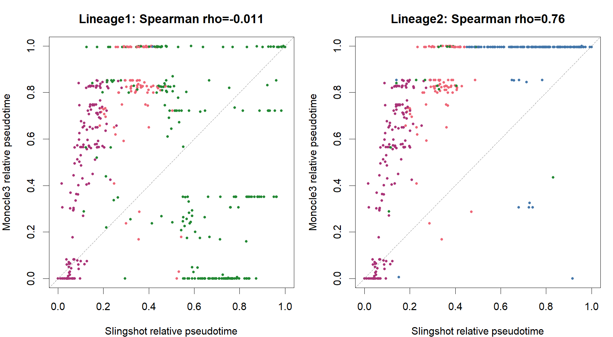

# 单细胞轨迹与命运：中文科研教学与应用手册

当前版本：2026-10-20，第四轮建设中。已建立[Private GitHub仓库](https://github.com/stevenhuangfannk-creator/single-cell-trajectory-fate-toolkit)，首发main提交99228954aa4872f97d6f844fae92396a31e94b91含423个文件。本轮PAGA已新增真实4组/12格式，中文教程与图卡已验收；CytoTRACE2等待Stanford非商业使用资格确认，CellRank按顺序尚未启动。当前进展见[第四轮记录](docs/round4/README_CN.md)。

第三轮Slingshot、tradeSeq、Monocle3及同650细胞组合的脚本、日志、图件和指南保持不变；**AWA排序/终点冲突与预处理敏感性保留，轨迹共识未成立**。见[第三轮历史总结](docs/ROUND3_DELIVERY_CN.md)。四轮当前累计29组实际科研图、87个PNG/PDF/SVG文件；其余方法没有用占位图冒充运行。

第一轮审查、scTour资产审查及六组合设计继续保留：[历史资料](docs/first_round/trajectory_fate_review_2026-10-19/README.md)。scTour历史科学状态仍为PARTIAL；RegVelo独立。本轮PI仅为研究设计。

## 从科研问题开始

1. **我想解决什么问题？** 先区分状态连续性、谱系内顺序、动态基因、预测潜能、终末命运、RNA动力学和真实时间状态转移；它们不是同一层面的答案。
2. **哪些方法适合？** 根据下表的输入条件选择。只有常规表达时先考虑结构；真实剪接层才支持RNA速度；真实采样时间才支持WOT。
3. **方法有何区别？** Slingshot拟合曲线，Monocle3学习分区主图，PAGA概括群间连接，tradeSeq检验轨迹条件下的表达变化；概率和潜能另有模型。
4. **数据要满足什么条件？** 细胞ID、计数/归一化尺度、谱系纯度、供者与批次须可追溯；根和终末需要依据。见 [数据契约](docs/DATA_CONTRACT_CN.md)。
5. **哪些可以组合？** 已有[Slingshot+tradeSeq+Monocle3同数据示范](combinations/Slingshot_tradeSeq_Monocle3/README_CN.md)，另保留[A–F设计教程](combinations/README_CN.md)。组合是待验证工作流，不是官方联合算法。
6. **先运行哪个脚本？** 本轮先读[第三轮00入口](round3/00_Start.R)，运行 `./run_round3.ps1 -Module tradeSeq`，再Monocle3、再combination；[详细环境](environments/round3/README_CN.md)。原[Slingshot指南](methods/Slingshot/README_CN.md)及脚本保持原样，不需重跑旧例。
7. **得到什么图与统计？** 累计29组真实图、87个PNG/PDF/SVG文件，包括轨迹、拟时序、动态曲线/热图、分支差异、方法比较与GO富集，另有收敛、FDR和输入校验表，见 [Gallery](gallery/README.md)。
8. **能支持什么结论？** 当前示例支持在记录的输入/模型条件下描述状态结构与动态表达；组合冲突显示预处理敏感性。不能据此证明PI状态转化、分化命运或疾病机制。

常用缩写与概念见[中文术语表](docs/GLOSSARY_CN.md)。

## 方法选择矩阵：14种，已包含tradeSeq

术语：拟时序（pseudotime）是相对状态排序；RNA 速度（RNA velocity）是基于转录本动力学的短时表达方向估计；分化潜能（potency）是模型预测能力；命运概率（fate probability）是在给定转移模型与终末定义下的概率；真实时间（experimental time）来自实验采样。它们不能互换。

| 科研问题 / 方法 | 必要输入与主要区别 | 主要图件及统计 | 组合与解释边界 |
|---|---|---|---|
| 轨迹、拟时序：[Monocle2](methods/Monocle2/SOURCE_CARD.md) | 表达与元数据；历史 DDRTree 降维与树样轨迹；旧依赖独立隔离 | 轨迹树、拟时序、分支相关表达与统计 | 适合历史研究复现；不以旧版树替代谱系追踪，不全局降级依赖 |
| 轨迹、拟时序：[Monocle3](methods/Monocle3/README_CN.md) | 原始计数、细胞/基因元数据；分区内主图与根锚定距离 | UMAP、主图、分区、拟时序、graph_test 统计 | A模块；不可达细胞可为 Inf；图上关联不能证明调控因果 |
| 轨迹、拟时序：[Slingshot](methods/Slingshot/README_CN.md) | 细胞×低维坐标、聚类、可说明依据的起点；最小例不需表达矩阵 | 最小生成树、主曲线、各谱系拟时序和曲线归属权重 | A/B模块；权重不是命运概率；结构依赖聚类与拟合空间 |
| 群体拓扑：[PAGA](methods/PAGA/README_CN.md) | 表达衍生的邻居图与群标签；连接图是群级抽象 | 群间连接图、嵌入；另运行 DPT 才有根依赖拟时序 | A的补充视角；连接强度不是方向、转移率或命运概率 |
| 动态排序：[scTour](methods/scTour/SOURCE_CARD.md) | 按官方要求准备表达；神经常微分方程学习潜在动态与时间 | 推断时间、潜空间、向量场、训练诊断 | A/C模块；先引用历史资产，不重训；时间不等于潜能或剪接速度 |
| 动态基因：[tradeSeq](methods/tradeSeq/README_CN.md) | 基因×细胞原始计数、谱系拟时序与权重；负二项广义加性模型 | 平滑曲线、热图、检验表、收敛率、多重检验校正 | B模块；不推断轨迹；整合矩阵不能替代计数；显著关联不是驱动机制 |
| 预测潜能：[CytoTRACE2](methods/CytoTRACE2/SOURCE_CARD.md) | 官方允许的未取对数表达、物种和基因覆盖 | 潜能分数、类别、嵌入图及技术混杂检查 | C模块；受训练域和输入影响；非商业许可需核查；不是实测干性 |
| 预测潜能：[FitDevo](methods/FitDevo/SOURCE_CARD.md) | 官方要求的表达尺度与基因匹配；区分是否已归一化 | 预测分化潜能及与标志物、深度的关系 | C的后续独立比较；许可未明确；不平均不同方法分数造新指数 |
| 命运、分化不确定性：[Palantir](methods/Palantir/SOURCE_CARD.md) | 表达/扩散空间、早期细胞、终末定义及连续谱系 | 拟时序、分支概率、分化不确定性 | D模块；概率熵不同于 CytoTRACE2 潜能；共享先验会造成一致性 |
| 命运：[CellRank](methods/CellRank/SOURCE_CARD.md) | 细胞图及可信方向输入；方向可来自拟时序、速度或真实时间 | 宏状态、终末状态、命运概率、驱动关联 | D/E及F后续衔接；必须说明核函数来源；概率不是实测转化频率 |
| RNA velocity：[scVelo](methods/scVelo/SOURCE_CARD.md) | 真实已剪接/未剪接计数、合适基因和动态信号 | 相图、速度流线、潜在时间、拟合诊断 | E模块；二维箭头是投影，不能据此证明细胞迁移或状态转化 |
| RNA 动力学：[Cell2fate](methods/Cell2fate/SOURCE_CARD.md) | 真实原始剪接层；独立历史依赖、训练和后验预算 | 动态模块、速度、拟合与后验不确定性 | E的后续独立比较；不能把 scVelo moments 当原始计数输入 |
| 真实时间序列：[WOT](methods/WOT/SOURCE_CARD.md) | 有单位的真实采样时间、可比表达空间、增长/死亡假设 | 最优传输耦合、祖先/后代分布、流量及敏感性 | F模块；PI/Healthy 不是时间；耦合不是单细胞真实谱系；旧接口需审查 |
| 表达景观/方向探索：[VECTOR](methods/VECTOR/SOURCE_CARD.md) | 按作者 R/Seurat 历史教程核对表达与预处理；不作为剪接速度模型 | 作者定义的表达状态向量场及轨迹展示 | 官方候选已核实，许可/旧环境未通过；不把向量箭头当命运概率 |

UMAP 指统一流形近似与投影（Uniform Manifold Approximation and Projection），用于低维展示；二维距离与分叉不能自动当作原始空间的生物学结构。DPT 指扩散拟时序（diffusion pseudotime）。DDRTree 是学习树形主图的降维方法，是Monocle2反向图嵌入的一种实现，具体细节在 Monocle2 教程展开。所有方法教程首次出现英文术语时给出中文说明。

原Slingshot入口为 `00_Start.R`；第三轮用 `round3/00_Start.R`，再选择一个方法顺序执行编号脚本，不提供会同时安装或运行所有方法的按钮。没有真实剪接计数时不推荐 E；没有真实时间时不推荐 F；没有可信方向时先做状态结构，暂不进入定向命运分析。

## 从本例开始学习

本图来自官方140点模拟低维坐标，不是UMAP，也不是患者数据。指定起点群1后，得到 `1→2→3→5` 与 `1→2→3→4` 两条路径。学习顺序：先读MST，再看主曲线，再解释每谱系拟时序与权重；[六张图逐图学习](gallery/README.md)。

完整运行退出码0，进程工作集采样峰值约721 MiB；拟合约0.37秒。输入140×2、5群，两个谱系的有效时间分别107/108个，缺失33/32个。75个细胞同时属于两条时间坐标，默认曲线权重行和可到2；**权重不是命运概率**。证据见 [运行记录](methods/Slingshot/logs/04_execution_record.json) 和 [验收](methods/Slingshot/STATUS.json)。

## 科研应用与平台进度

- [PI Fibroblast专题](case_studies/PI_Fibroblast_State_Reprogramming/README_CN.md)：State 1/6/7、ECM、机械转导、炎症/修复、候选潜能与终末、内皮微环境衔接；仅设计，未运行真实PI。
- [六组合教程](combinations/README_CN.md)：输入、顺序、比较规则、冲突解释与论文图件；未将组合宣称为官方算法。
- [环境与复现](environments/README_CN.md)：独立R、实际版本锁、下载校验、真实失败与修复；不混装scTour/RegVelo。
- [当前验收与局限](docs/REPRODUCTION_STATUS_CN.md)：三方法分别验收、组合单独验收，默认关联检验NA和AWA冲突均保留。
- [第三方许可与来源](THIRD_PARTY_NOTICES.md)：示例、改写代码与第一轮资产分别说明；大数据、模型和运行时不入库。

本轮保留14方法来源、scTour资产审查、环境隔离和六组合设计。所有来源卡的第一轮 NOT_TESTED 均为历史快照；新的实际状态在当前方法 STATUS.json 中查看。未把来源登记、历史图或预期图冒充本次运行。第三轮实际结果见[新验收](ACCEPTANCE.json)；下一步先解决组合结构敏感性，再逐步扩展PAGA、CellRank、CytoTRACE2。

## 第三轮实际图件与学习入口

[tradeSeq完整中文指南](methods/tradeSeq/README_CN.md)：官方240×2660示例，五类检验、额外数值敏感性，240/240收敛。默认associationTest仍有126个NA，未当作阴性或删除隐瞒。

[Monocle3完整中文指南](methods/Monocle3/README_CN.md)：官方10000×1805小数据，3分区、148图节点、5921基因动态检验。跨分区拟时序不可直接当作共同生物时间。

[组合教程](combinations/Slingshot_tradeSeq_Monocle3/README_CN.md) · [一致性/冲突报告](combinations/Slingshot_tradeSeq_Monocle3/AGREEMENT_LIMITATIONS_CN.md) · [Slingshot第三轮补充](methods/Slingshot/ROUND3_SUPPLEMENT_CN.md) · [PI动态程序设计](case_studies/PI_Fibroblast_State_Reprogramming/ROUND3_DYNAMIC_DESIGN_CN.md)。

[第三轮发布前审查（历史）](docs/GITHUB_PREPUBLICATION_CN.md)及[第四轮实际Private发布](docs/round4/FIRST_PRIVATE_PUSH.json)分别保留。用户已授权Private仓库与push；没有授权Public。自写内容尚未授予开源许可证，第三方权利仍适用。

## 第四轮PAGA实际教学示范

[完整PAGA中文指南](methods/PAGA/README_CN.md)：官方2730细胞×3451基因小例，19群、58条非零连接、54条显示边。根条件DPT有限2671个、不可达59个，默认根位于8Mk，不能直接叫干祖起点。[四轮PI预设设计](case_studies/PI_Fibroblast_State_Reprogramming/ROUND4_METHOD_DESIGN_CN.md)说明如何研究State1/6/7、ECM、机械转导与炎症；未运行真实PI。
