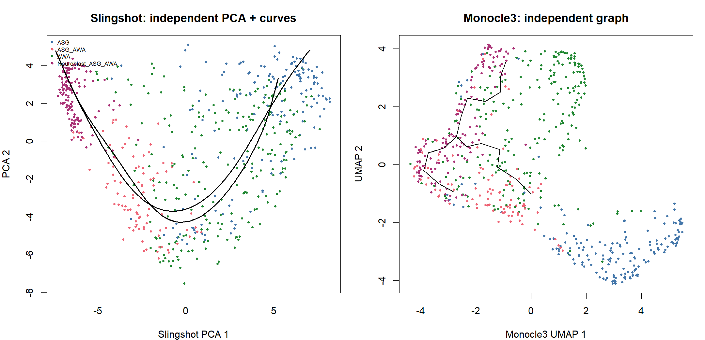

# C01_independent_trajectory_comparison：独立轨迹结构对照

1. **图名/方法**：独立轨迹结构对照；Slingshot + tradeSeq + Monocle3待验证研究流程。
2. **原始来源**：[官方神经元小数据](https://github.com/cole-trapnell-lab/monocle3/blob/v1.4.27/inst/extdata/worm_embryo/NOTES)、[tradeSeq教程](https://statomics.github.io/tradeSeq/articles/tradeSeq.html)、[Monocle3教程](https://cole-trapnell-lab.github.io/monocle3/docs/trajectories/)。组合图为本项目新计算，不是官方联合算法图。
3. **实际数据/脚本**：同650细胞、同10,000基因输入；[生成脚本](../scripts/04_Plot_and_Export.R)，统计和ID清单在results；来源/hash见全库登记，GO另有注释快照。
4. **元素解释**：左侧20维PCA曲线的前两维投影，右侧独立MC UMAP/主图；相同颜色表示ASG、ASG_AWA、AWA和神经母细胞。
5. **回答问题**：同一细胞系统的两种流程是否给出相容结构。
6. **本例解释**：图形表示与主图覆盖不同；PCA投影不能与UMAP坐标量尺直接比较。
7. **局限/误读**：不同表示/批次处理/聚类同时改变，不能把形状差异全归因核心算法。
8. **PI中用法（仅设计）**：检查PI状态覆盖与路径稳定性，拒绝手动拼成预期树。

[PDF](../figures/C01_independent_trajectory_comparison.pdf) · [SVG](../figures/C01_independent_trajectory_comparison.svg)。主要流程和敏感性结果不相互替代。
