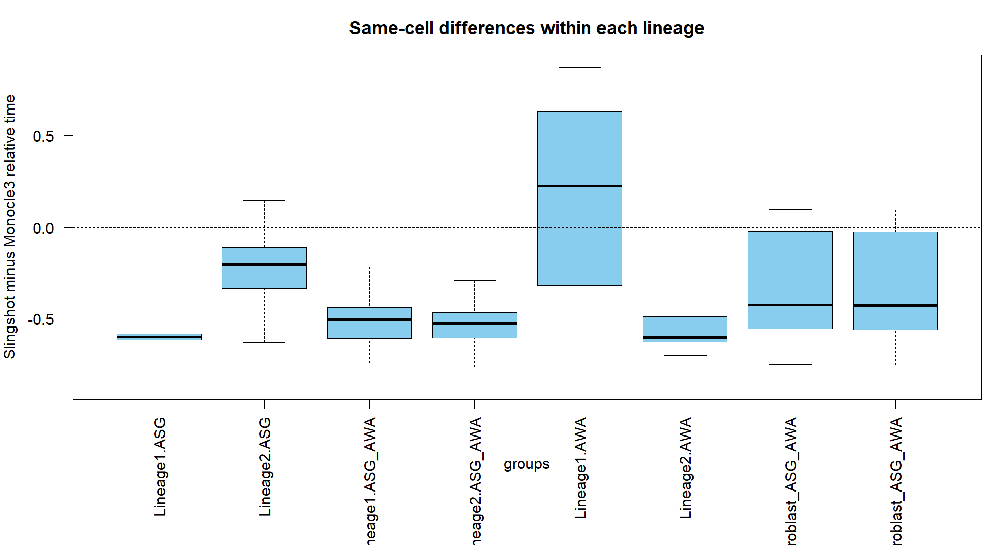

# C03_pseudotime_difference：相对拟时序差值

1. **图名/方法**：相对拟时序差值；Slingshot + tradeSeq + Monocle3待验证研究流程。
2. **原始来源**：[官方神经元小数据](https://github.com/cole-trapnell-lab/monocle3/blob/v1.4.27/inst/extdata/worm_embryo/NOTES)、[tradeSeq教程](https://statomics.github.io/tradeSeq/articles/tradeSeq.html)、[Monocle3教程](https://cole-trapnell-lab.github.io/monocle3/docs/trajectories/)。组合图为本项目新计算，不是官方联合算法图。
3. **实际数据/脚本**：同650细胞、同10,000基因输入；[生成脚本](../scripts/04_Plot_and_Export.R)，统计和ID清单在results；来源/hash见全库登记，GO另有注释快照。
4. **元素解释**：横轴为谱系×注释组合，纵轴SS减MC的相对时间；箱线图展示中位/四分位，隐藏离群点仅为排版。
5. **回答问题**：偏差是否集中在某些状态/路径。
6. **本例解释**：主要流程AWA有系统差异；共享祖细胞在两谱系重复出现。
7. **局限/误读**：差值不是分钟或速度；不同归一化范围会影响它，不能当独立样本检验。
8. **PI中用法（仅设计）**：定位受预处理或覆盖影响的状态，再做供者层面审查。

[PDF](../figures/C03_pseudotime_difference.pdf) · [SVG](../figures/C03_pseudotime_difference.svg)。主要流程和敏感性结果不相互替代。
