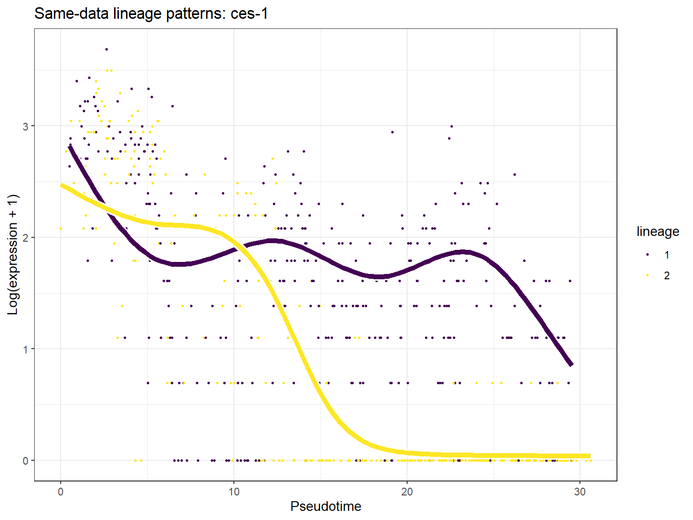

# C04_tradeSeq_lineage_smoothers：ces-1谱系表达平滑

1. **图名/方法**：ces-1谱系表达平滑；Slingshot + tradeSeq + Monocle3待验证研究流程。
2. **原始来源**：[官方神经元小数据](https://github.com/cole-trapnell-lab/monocle3/blob/v1.4.27/inst/extdata/worm_embryo/NOTES)、[tradeSeq教程](https://statomics.github.io/tradeSeq/articles/tradeSeq.html)、[Monocle3教程](https://cole-trapnell-lab.github.io/monocle3/docs/trajectories/)。组合图为本项目新计算，不是官方联合算法图。
3. **实际数据/脚本**：同650细胞、同10,000基因输入；[生成脚本](../scripts/04_Plot_and_Export.R)，统计和ID清单在results；来源/hash见全库登记，GO另有注释快照。
4. **元素解释**：点是共同数据原始计数的log(1+count)显示，横轴SS拟时序；不同颜色曲线为谱系，来自6结点NB-GAM。
5. **回答问题**：在当前SS轨迹下，表达模式是否因谱系不同。
6. **本例解释**：ces-1由patternTest稳定排序选取；模型条件于当前时间/权重。
7. **局限/误读**：分支特异表达不等于驱动分叉，MC排序冲突仍然存在。
8. **PI中用法（仅设计）**：用于预登记ECM/机械/炎症候选基因的条件描述。

[PDF](../figures/C04_tradeSeq_lineage_smoothers.pdf) · [SVG](../figures/C04_tradeSeq_lineage_smoothers.svg)。主要流程和敏感性结果不相互替代。
