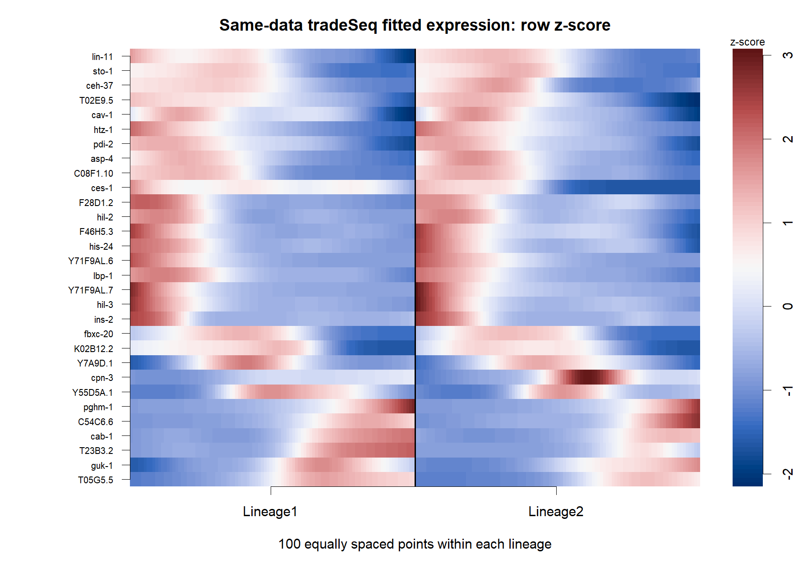

# C05_dynamic_gene_heatmap：共同数据动态热图

1. **图名/方法**：共同数据动态热图；Slingshot + tradeSeq + Monocle3待验证研究流程。
2. **原始来源**：[官方神经元小数据](https://github.com/cole-trapnell-lab/monocle3/blob/v1.4.27/inst/extdata/worm_embryo/NOTES)、[tradeSeq教程](https://statomics.github.io/tradeSeq/articles/tradeSeq.html)、[Monocle3教程](https://cole-trapnell-lab.github.io/monocle3/docs/trajectories/)。组合图为本项目新计算，不是官方联合算法图。
3. **实际数据/脚本**：同650细胞、同10,000基因输入；[生成脚本](../scripts/04_Plot_and_Export.R)，统计和ID清单在results；来源/hash见全库登记，GO另有注释快照。
4. **元素解释**：每谱系100个网格、每行一个基因；颜色为log1p拟合均值的行z分数，右侧有色条。
5. **回答问题**：动态程序的相对形状和分支差异。
6. **本例解释**：300个高变筛选基因中按关联排序展示30个；行聚类只是展示。
7. **局限/误读**：颜色不是跨基因绝对量，网格不是新细胞，面板不是全基因组。
8. **PI中用法（仅设计）**：预登记功能程序并报告集合重叠和缺失基因。

[PDF](../figures/C05_dynamic_gene_heatmap.pdf) · [SVG](../figures/C05_dynamic_gene_heatmap.svg)。主要流程和敏感性结果不相互替代。
