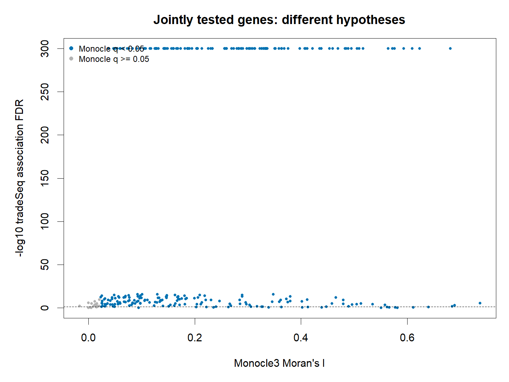

# C06_joint_gene_test_comparison：共同基因的不同假设检验

1. **图名/方法**：共同基因的不同假设检验；Slingshot + tradeSeq + Monocle3待验证研究流程。
2. **原始来源**：[官方神经元小数据](https://github.com/cole-trapnell-lab/monocle3/blob/v1.4.27/inst/extdata/worm_embryo/NOTES)、[tradeSeq教程](https://statomics.github.io/tradeSeq/articles/tradeSeq.html)、[Monocle3教程](https://cole-trapnell-lab.github.io/monocle3/docs/trajectories/)。组合图为本项目新计算，不是官方联合算法图。
3. **实际数据/脚本**：同650细胞、同10,000基因输入；[生成脚本](../scripts/04_Plot_and_Export.R)，统计和ID清单在results；来源/hash见全库登记，GO另有注释快照。
4. **元素解释**：横轴MC Moran I，纵轴−log10 SS下游tradeSeq FDR；蓝色为MC q<.05，灰色反之。
5. **回答问题**：两个条件检验在共同基因宇宙的交集/分歧。
6. **本例解释**：298个共同有效基因，交集263、Jaccard0.8976；p下溢按1e−300限制显示。
7. **局限/误读**：假设不同且共享表达，高交集不是独立验证，不等于轨迹一致。
8. **PI中用法（仅设计）**：在共同可检验背景中比较程序，避免仅取两张显著表交集。

[PDF](../figures/C06_joint_gene_test_comparison.pdf) · [SVG](../figures/C06_joint_gene_test_comparison.svg)。主要流程和敏感性结果不相互替代。
