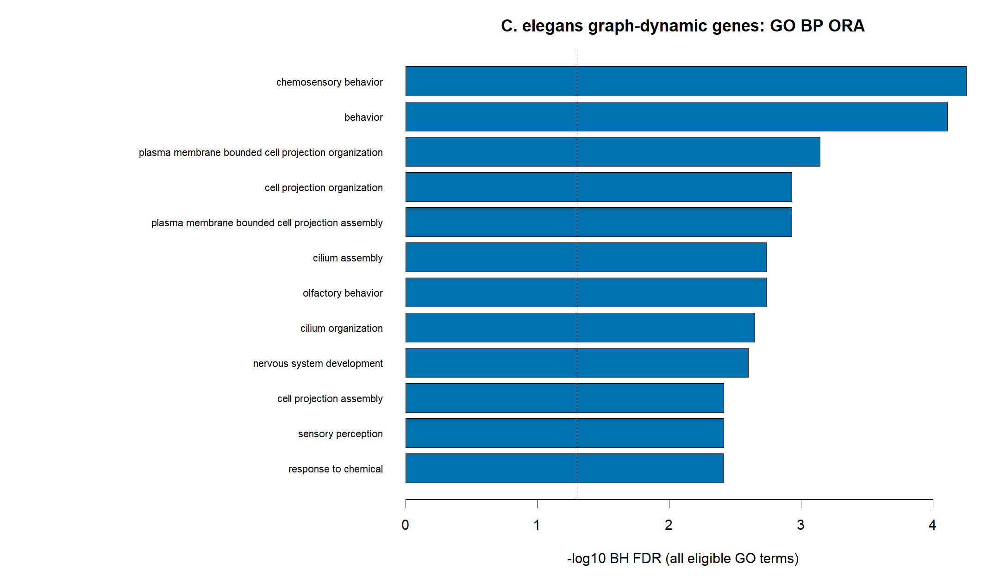

# C07_GO_dynamic_programs：图动态基因GO生物过程富集

1. **图名/方法**：图动态基因GO生物过程富集；Slingshot + tradeSeq + Monocle3待验证研究流程。
2. **原始来源**：[官方神经元小数据](https://github.com/cole-trapnell-lab/monocle3/blob/v1.4.27/inst/extdata/worm_embryo/NOTES)、[tradeSeq教程](https://statomics.github.io/tradeSeq/articles/tradeSeq.html)、[Monocle3教程](https://cole-trapnell-lab.github.io/monocle3/docs/trajectories/)。组合图为本项目新计算，不是官方联合算法图。
3. **实际数据/脚本**：同650细胞、同10,000基因输入；[生成脚本](../scripts/06_Functional_Analysis.R)，统计和ID清单在results；来源/hash见全库登记，GO另有注释快照。
4. **元素解释**：横轴−log10 BH FDR，纵轴GO条目；蓝色阈值内、灰色阈值外，虚线FDR.05。
5. **回答问题**：图动态集合是否过度包含特定功能注释。
6. **本例解释**：2177背景、196入选、948检验、22显著；首条chemosensory behavior约5.18倍。
7. **局限/误读**：不是有方向GSEA；GO相关父子词并非独立机制；未测行为或PI病理。
8. **PI中用法（仅设计）**：换成人类/对应物种和真实检验宇宙，不能复用线虫背景。

[PDF](../figures/C07_GO_dynamic_programs.pdf) · [SVG](../figures/C07_GO_dynamic_programs.svg)。主要流程和敏感性结果不相互替代。
