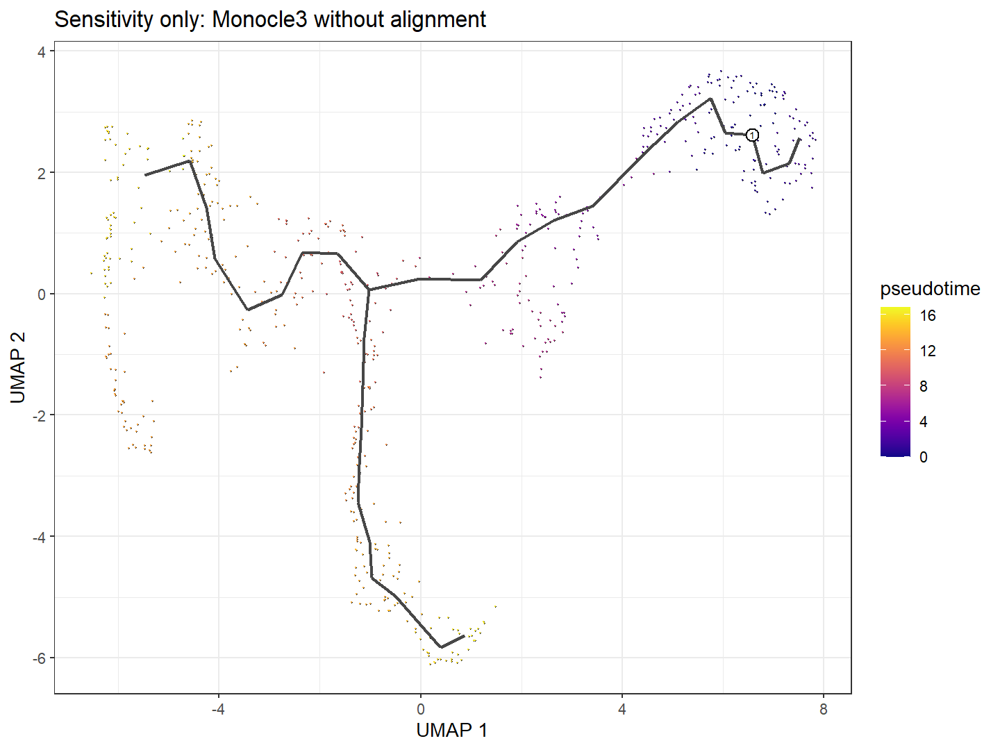

# C08_no_alignment_sensitivity：不对齐的事后敏感性主图

1. **图名/方法**：不对齐的事后敏感性主图；Slingshot + tradeSeq + Monocle3待验证研究流程。
2. **原始来源**：[官方神经元小数据](https://github.com/cole-trapnell-lab/monocle3/blob/v1.4.27/inst/extdata/worm_embryo/NOTES)、[tradeSeq教程](https://statomics.github.io/tradeSeq/articles/tradeSeq.html)、[Monocle3教程](https://cole-trapnell-lab.github.io/monocle3/docs/trajectories/)。组合图为本项目新计算，不是官方联合算法图。
3. **实际数据/脚本**：同650细胞、同10,000基因输入；[生成脚本](../scripts/07_Sensitivity_No_Alignment.R)，统计和ID清单在results；来源/hash见全库登记，GO另有注释快照。
4. **元素解释**：同650细胞重新由计数构建MC但不align；颜色是新流程拟时序，黑线新主图。
5. **回答问题**：主要冲突是否依赖批次/背景对齐步骤。
6. **本例解释**：AWA rho升到0.6321，ASG0.7424；主要结果单独保留。
7. **局限/误读**：事后敏感性不是独立验证；较高相关不能裁决生物学真值。
8. **PI中用法（仅设计）**：真实PI中对批次/发育混杂做预登记敏感性和供者验证。

[PDF](../sensitivity_no_alignment/figures/C08_no_alignment_sensitivity.pdf) · [SVG](../sensitivity_no_alignment/figures/C08_no_alignment_sensitivity.svg)。主要流程和敏感性结果不相互替代。
