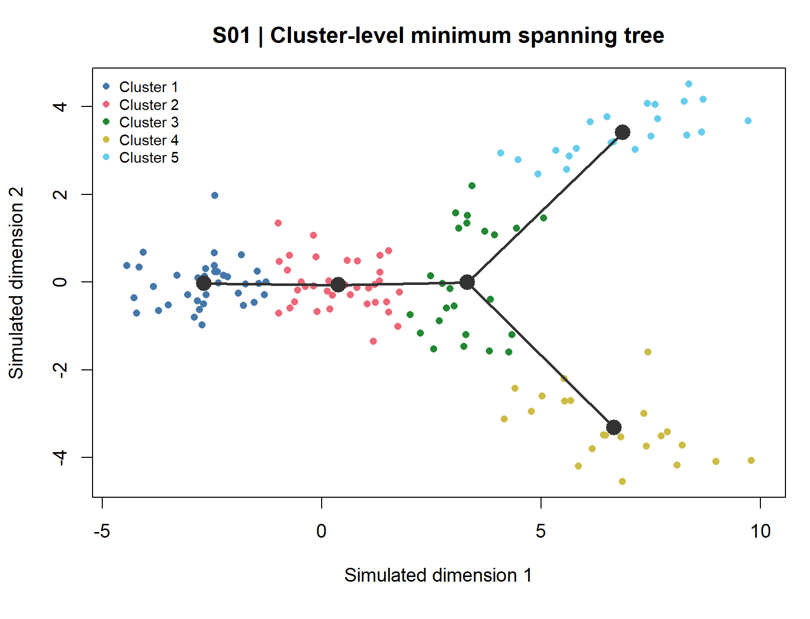
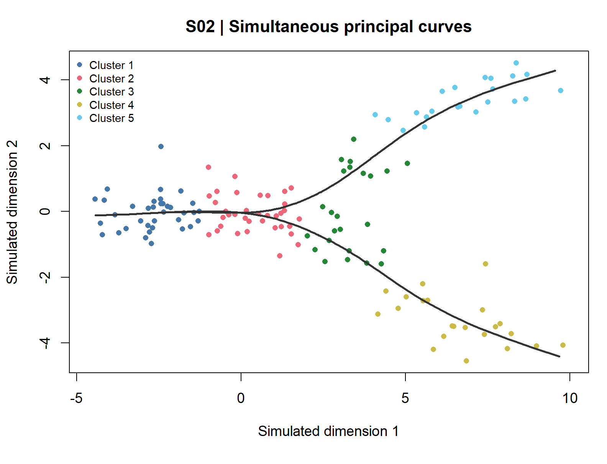
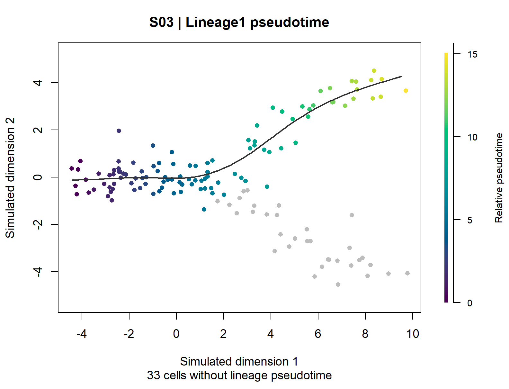
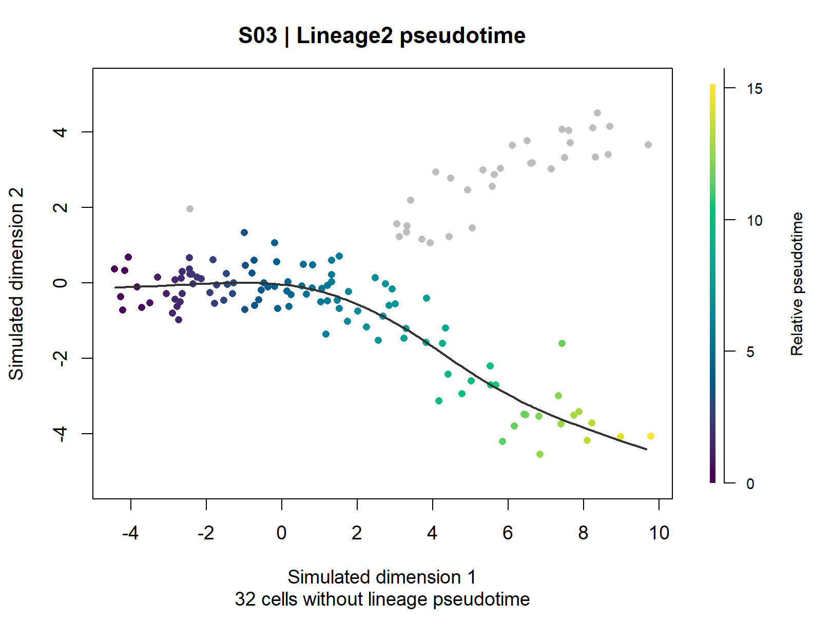
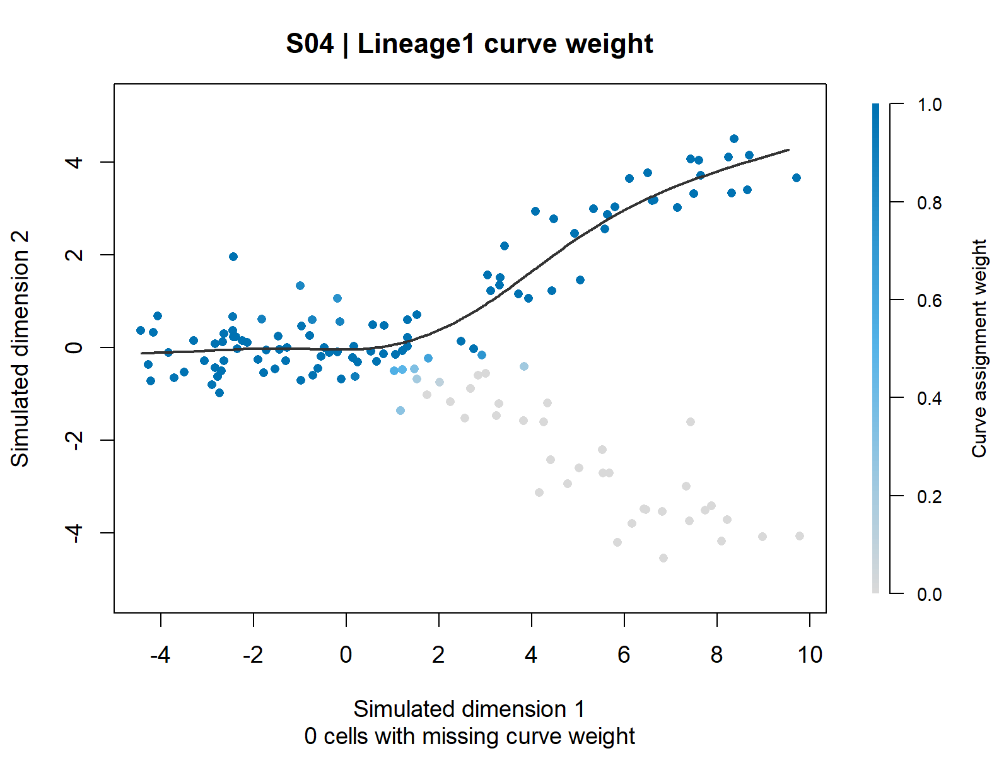
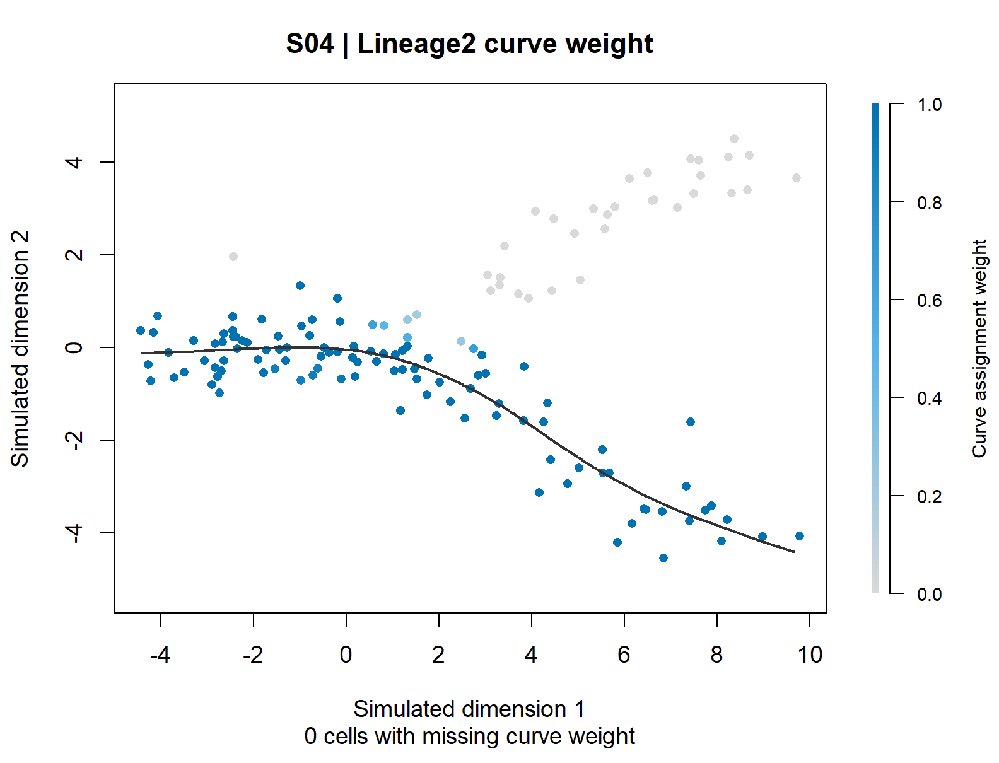

# Figure Gallery：真实结果与图形学习

当前累计25组真实图、75个三格式文件；包括原Slingshot 6组和第三轮19组。每图链接具体数据、脚本、解释和局限。历史scTour仍为PARTIAL，入口见[第一轮Gallery](../docs/first_round/trajectory_fate_review_2026-10-19/gallery/README.md)，未复制为本次结果。

## 轨迹：S01：Slingshot 聚类层级最小生成树

[中文逐图解读](../methods/Slingshot/figure_notes/S01_cluster_MST_CN.md) · [PDF](../methods/Slingshot/figures/S01_cluster_MST.pdf) · [SVG](../methods/Slingshot/figures/S01_cluster_MST.svg)

群级结构是否支持共享前段和两个末端？哪些群通过树的边相连？ 五群大小36、36、24、22、22。以群1为起点，路径为1→2→3→5和1→2→3→4，群3是两条路径共享的分支区域。 注意：树会受聚类和拟合空间影响；一条边不说明细胞真实互相转化，边长不是真实时间，节点不是独立生物重复。

## 轨迹：S02：Slingshot 同时主曲线

[中文逐图解读](../methods/Slingshot/figure_notes/S02_principal_curves_CN.md) · [PDF](../methods/Slingshot/figures/S02_principal_curves.pdf) · [SVG](../methods/Slingshot/figures/S02_principal_curves.svg)

细胞分布能否用共享早期段和两条光滑路径概括？群级骨架与细胞级平滑路径有何不同？ 主曲线共享靠近群1/2的前段；随后一条延向群5，另一条延向群4。两条末端是算法在本模拟例中的几何结果。 注意：平滑外观不代表模型已做生物学验证；稀疏区域的曲线延伸容易被误读。不能由曲线远近推断转化速率或迁移。

## 拟时序：S03-L1：Slingshot 谱系1拟时序

[中文逐图解读](../methods/Slingshot/figure_notes/S03_Lineage1_pseudotime_CN.md) · [PDF](../methods/Slingshot/figures/S03_Lineage1_pseudotime.pdf) · [SVG](../methods/Slingshot/figures/S03_Lineage1_pseudotime.svg)

在1→2→3→5这条路径内，哪些细胞相对靠前或靠后？哪些细胞不适合赋予这条路径的时间？ 107个细胞有有限拟时序，33个为NA；范围0–15.045364。灰点仍保留在图中，没有被删除或填成0。 注意：数值不是天数；NA不是死亡或低质量；不能把谱系2的所有细胞硬塞进这条线，也不能以该范围推断分化速度。

## 拟时序：S03-L2：Slingshot 谱系2拟时序

[中文逐图解读](../methods/Slingshot/figure_notes/S03_Lineage2_pseudotime_CN.md) · [PDF](../methods/Slingshot/figures/S03_Lineage2_pseudotime.pdf) · [SVG](../methods/Slingshot/figures/S03_Lineage2_pseudotime.svg)

在1→2→3→4内，哪些细胞有可解释的相对顺序？与谱系1共享哪些早期细胞？ 108个细胞有有限拟时序，32个NA，范围0–15.126327。两条谱系共有75个细胞具有有限时间；它们的两个值不能直接平均成全局时间。 注意：相近的最大值不证明两个分支发生得同样快。不同谱系的相对位置不等于实测同一时间点。

## 归属权重：S04-L1：Slingshot 谱系1曲线归属权重

[中文逐图解读](../methods/Slingshot/figure_notes/S04_Lineage1_curve_weight_CN.md) · [PDF](../methods/Slingshot/figures/S04_Lineage1_curve_weight.pdf) · [SVG](../methods/Slingshot/figures/S04_Lineage1_curve_weight.svg)

哪些细胞参与谱系1曲线的拟合与归属？为什么早期共享区也可能对另一条曲线有高权重？ 单谱系权重范围0–1。跨谱系行和范围1–2；32个细胞在两条曲线上均为1。共享区允许重复归属。 注意：这不是到达群5的概率；行和不要求为1，不应为做饼图而直接归一化并换名称。高权重也不证明方向或终末真实性。

## 归属权重：S04-L2：Slingshot 谱系2曲线归属权重

[中文逐图解读](../methods/Slingshot/figure_notes/S04_Lineage2_curve_weight_CN.md) · [PDF](../methods/Slingshot/figures/S04_Lineage2_curve_weight.pdf) · [SVG](../methods/Slingshot/figures/S04_Lineage2_curve_weight.svg)

谱系2的归属结构如何与谱系1分离？哪些细胞位于共享区或不同分支？ 群4方向的细胞主要呈高谱系2权重，群5方向主要低；共享前段可同时对两个谱系高权重。两个权重面板需要一起看。 注意：不能把两幅图的颜色看成经过校准的两终末概率。拟合权重依赖当前聚类、空间、曲线及重分配设置。

## 后续分类与历史边界

UMAP、动态基因、预测潜能、命运概率、RNA速度、热图、真实时间转移将在相应方法真实运行后纳入。本次模拟坐标图不挂在UMAP分类下。没有空白缩略图、预期结果图或伪造运行状态。

每张解读页均覆盖图名/方法、官方来源、实际数据/脚本、元素、问题、实际解释、科学限制、PI用途八项。图件科学解释必须与同一运行的小表对应，不能只凭形状或配色写结论。

## 第三轮分类学习索引

每张卡均有8项来源、数据脚本、元素、问题、结果、局限和PI设计说明；图件来自实际运行。

| 分类 | 逐图阅读卡 |
|---|---|
| 轨迹/UMAP | [T01_official_trajectory](../methods/tradeSeq/figure_notes/T01_official_trajectory_CN.md) |
| 轨迹/UMAP | [M01_celltypes_principal_graph](../methods/Monocle3/figure_notes/M01_celltypes_principal_graph_CN.md) |
| 轨迹/UMAP | [M02_partitions](../methods/Monocle3/figure_notes/M02_partitions_CN.md) |
| 轨迹/UMAP | [M03_rooted_pseudotime](../methods/Monocle3/figure_notes/M03_rooted_pseudotime_CN.md) |
| 轨迹/UMAP | [M04_embryo_time](../methods/Monocle3/figure_notes/M04_embryo_time_CN.md) |
| 轨迹/对照 | [C01_independent_trajectory_comparison](../combinations/Slingshot_tradeSeq_Monocle3/figure_notes/C01_independent_trajectory_comparison_CN.md) |
| 动态基因/曲线 | [T02_expression_smoothers](../methods/tradeSeq/figure_notes/T02_expression_smoothers_CN.md) |
| 动态基因/分支 | [T04_lineage_pattern_difference](../methods/tradeSeq/figure_notes/T04_lineage_pattern_difference_CN.md) |
| 动态基因/空间 | [M05_dynamic_gene_maps](../methods/Monocle3/figure_notes/M05_dynamic_gene_maps_CN.md) |
| 动态基因/曲线 | [M06_gene_expression_pseudotime](../methods/Monocle3/figure_notes/M06_gene_expression_pseudotime_CN.md) |
| 动态基因/曲线 | [C04_tradeSeq_lineage_smoothers](../combinations/Slingshot_tradeSeq_Monocle3/figure_notes/C04_tradeSeq_lineage_smoothers_CN.md) |
| 热图 | [T03_dynamic_gene_heatmap](../methods/tradeSeq/figure_notes/T03_dynamic_gene_heatmap_CN.md) |
| 热图 | [C05_dynamic_gene_heatmap](../combinations/Slingshot_tradeSeq_Monocle3/figure_notes/C05_dynamic_gene_heatmap_CN.md) |
| 统计/方法比较 | [T05_test_summary](../methods/tradeSeq/figure_notes/T05_test_summary_CN.md) |
| 统计/方法比较 | [C02_per_lineage_pseudotime](../combinations/Slingshot_tradeSeq_Monocle3/figure_notes/C02_per_lineage_pseudotime_CN.md) |
| 统计/方法比较 | [C03_pseudotime_difference](../combinations/Slingshot_tradeSeq_Monocle3/figure_notes/C03_pseudotime_difference_CN.md) |
| 统计/方法比较 | [C06_joint_gene_test_comparison](../combinations/Slingshot_tradeSeq_Monocle3/figure_notes/C06_joint_gene_test_comparison_CN.md) |
| 功能注释 | [C07_GO_dynamic_programs](../combinations/Slingshot_tradeSeq_Monocle3/figure_notes/C07_GO_dynamic_programs_CN.md) |
| 轨迹/敏感性 | [C08_no_alignment_sensitivity](../combinations/Slingshot_tradeSeq_Monocle3/figure_notes/C08_no_alignment_sensitivity_CN.md) |

潜能、命运概率和RNA速度尚未在本轮生成；不以占位图代替运行。共同数据AWA冲突见组合报告，图件完成不等于生物学一致性通过。
