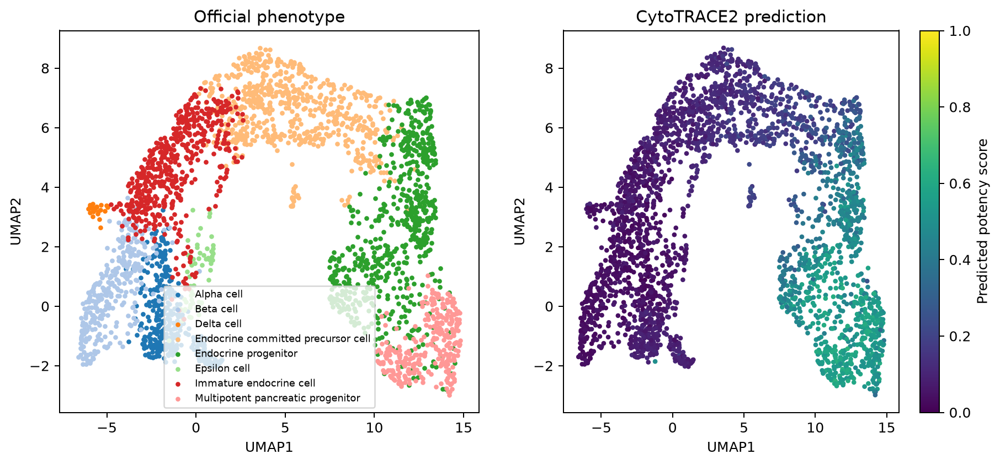

# 官方表型与预测潜能UMAP（CytoTRACE2）

1. **名称与方法**：官方表型与预测潜能UMAP，CytoTRACE2官方预测API及本仓库独立绘图。
2. **论文/教程来源**：[Kang等2025](https://doi.org/10.1038/s41592-025-02857-2)、[官方Python教程](https://github.com/digitalcytometry/cytotrace2/tree/main/cytotrace2_python)。不是复制官方截图。
3. **实际数据与脚本**：官方小鼠胰腺完整2850细胞；[输入来源及SHA256](../results/input_download_provenance.json)。[01输入/UMAP](../scripts/01_Input_QC_and_Embedding.py)、[02预测](../scripts/02_Predict_and_Statistics.py)、[03绘图](../scripts/03_Plot_and_Export.py)。[数值摘要](../results/run_summary.json)。
4. **图形元素**：左图每色为官方表型；右图同一坐标用0–1连续色表示最终潜能。每点一个细胞，坐标轴仅为二维嵌入，没有时间单位。没有方向箭头。
5. **回答的问题**：哪些表型区域有较高预测潜能？同一表型内部是否异质？
6. **本次解释**：实际2850细胞，分数0.0041–0.6461。多能胰腺祖细胞及内分泌祖细胞区域总体分数较高，Beta/Delta等成熟表型较低；它支持与官方注释相容的预测分布。颜色连续仍是展示结果，不确定状态转变方向，需结合表型统计和QC阅读。
7. **局限与常见误读**：独立轻量UMAP不参与潜能模型；几何邻近和平滑颜色不能证明祖先后代或去分化。
8. **PI预设用途**：在每供者State1/6/7分布上叠加潜能，先排查深度/覆盖，避免将炎症激活称作高干性。 本轮未运行真实PI。

下载：[PNG](../figures/CT01_potency_UMAP.png) / [PDF](../figures/CT01_potency_UMAP.pdf) / [SVG](../figures/CT01_potency_UMAP.svg)。所有三种格式来自同次本地绘图，不是占位。完整参数、资源适配与科学边界见[中文指南](../README_CN.md)。
