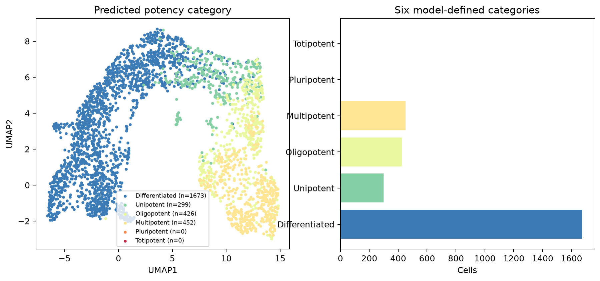

# 预测潜能六类及细胞数（CytoTRACE2）

1. **名称与方法**：预测潜能六类及细胞数，CytoTRACE2官方预测API及本仓库独立绘图。
2. **论文/教程来源**：[Kang等2025](https://doi.org/10.1038/s41592-025-02857-2)、[官方Python教程](https://github.com/digitalcytometry/cytotrace2/tree/main/cytotrace2_python)。不是复制官方截图。
3. **实际数据与脚本**：官方小鼠胰腺完整2850细胞；[输入来源及SHA256](../results/input_download_provenance.json)。[01输入/UMAP](../scripts/01_Input_QC_and_Embedding.py)、[02预测](../scripts/02_Predict_and_Statistics.py)、[03绘图](../scripts/03_Plot_and_Export.py)。[数值摘要](../results/run_summary.json)。
4. **图形元素**：左为六类离散颜色；右条长是各类细胞数，包含计数为零的类别。坐标与CT01相同。类别是分数六等分阈值，不是六条谱系。
5. **回答的问题**：模型将哪些细胞放入哪些潜能区间？最高类别是否真实出现？
6. **本次解释**：实际类别计数为{'Differentiated': 1673, 'Multipotent': 452, 'Oligopotent': 426, 'Unipotent': 299, 'Pluripotent': 0, 'Totipotent': 0}；未出现的类别不能画出虚构细胞。
7. **局限与常见误读**：Totipotent等是模型标签，不能据此称成纤维细胞具有胚胎全能性；类别阈值附近轻微分数变化可改变标签。
8. **PI预设用途**：预先报告连续分数及全部类别，不以最醒目标签为PI状态命名。 本轮未运行真实PI。

下载：[PNG](../figures/CT02_potency_categories.png) / [PDF](../figures/CT02_potency_categories.pdf) / [SVG](../figures/CT02_potency_categories.svg)。所有三种格式来自同次本地绘图，不是占位。完整参数、资源适配与科学边界见[中文指南](../README_CN.md)。
