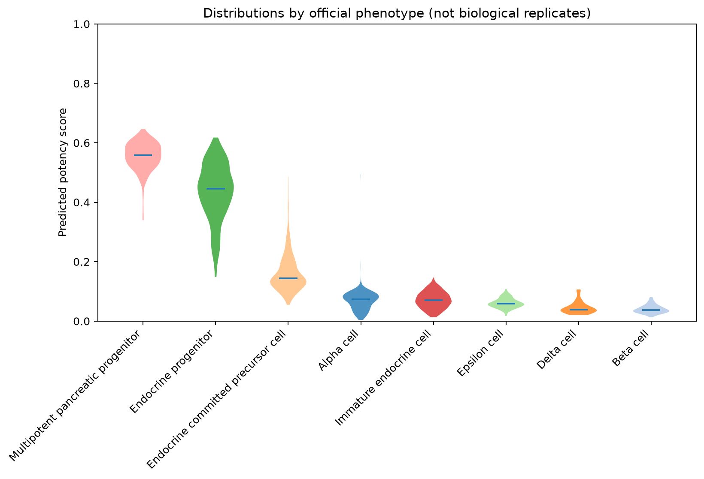

# 官方表型潜能分布（CytoTRACE2）

1. **名称与方法**：官方表型潜能分布，CytoTRACE2官方预测API及本仓库独立绘图。
2. **论文/教程来源**：[Kang等2025](https://doi.org/10.1038/s41592-025-02857-2)、[官方Python教程](https://github.com/digitalcytometry/cytotrace2/tree/main/cytotrace2_python)。不是复制官方截图。
3. **实际数据与脚本**：官方小鼠胰腺完整2850细胞；[输入来源及SHA256](../results/input_download_provenance.json)。[01输入/UMAP](../scripts/01_Input_QC_and_Embedding.py)、[02预测](../scripts/02_Predict_and_Statistics.py)、[03绘图](../scripts/03_Plot_and_Export.py)。[数值摘要](../results/run_summary.json)。
4. **图形元素**：横轴官方表型，按本例中位数降序排列；纵轴0–1潜能；小提琴宽度是核密度估计，内线为中位数。颜色沿用表型。
5. **回答的问题**：表型内的分散与表型间的中心位置有何差别？
6. **本次解释**：多能胰腺祖细胞中位数0.5587（306细胞），内分泌祖细胞0.4456（654），内分泌定向前体0.1437（626），Beta细胞0.0377（309）。这与表型成熟程度的预期相容，但不是谱系追踪；横轴排序是描述性，不是独立验证的发育次序。全部统计见phenotype_score_summary.csv。
7. **局限与常见误读**：宽度不等于样本量；不同表型细胞不构成独立供者重复。不得用细胞级显著性代替供者效应。
8. **PI预设用途**：PI/Healthy按供者展示State1/6/7分数，疾病效应采用供者层统计并检查组成。 本轮未运行真实PI。

下载：[PNG](../figures/CT03_phenotype_violin.png) / [PDF](../figures/CT03_phenotype_violin.pdf) / [SVG](../figures/CT03_phenotype_violin.svg)。所有三种格式来自同次本地绘图，不是占位。完整参数、资源适配与科学边界见[中文指南](../README_CN.md)。
