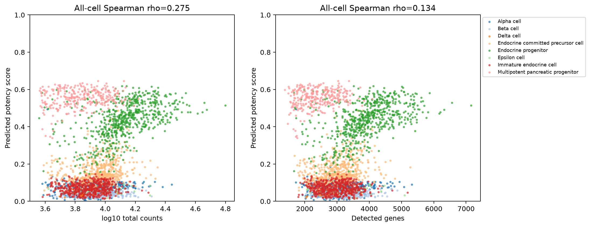

# 测序深度与检测基因混杂检查（CytoTRACE2）

1. **名称与方法**：测序深度与检测基因混杂检查，CytoTRACE2官方预测API及本仓库独立绘图。
2. **论文/教程来源**：[Kang等2025](https://doi.org/10.1038/s41592-025-02857-2)、[官方Python教程](https://github.com/digitalcytometry/cytotrace2/tree/main/cytotrace2_python)。不是复制官方截图。
3. **实际数据与脚本**：官方小鼠胰腺完整2850细胞；[输入来源及SHA256](../results/input_download_provenance.json)。[01输入/UMAP](../scripts/01_Input_QC_and_Embedding.py)、[02预测](../scripts/02_Predict_and_Statistics.py)、[03绘图](../scripts/03_Plot_and_Export.py)。[数值摘要](../results/run_summary.json)。
4. **图形元素**：左横轴log10总计数，右横轴检测基因数；纵轴潜能；颜色为表型。标题给出全局Spearman秩相关，无因果箭头。
5. **回答的问题**：潜能与技术量是否伴随变化？全局关联是否被细胞组成驱动？
6. **本次解释**：n_counts rho=0.275；n_genes rho=0.134；mito_fraction rho=0.086。完整表还报告表型内相关和描述性BH校正，不只挑全局结果。
7. **局限与常见误读**：内分泌祖细胞内部与总计数及检测基因数的rho均约0.524，明显高于全局检测基因相关0.134，说明只看全局会低估部分群内关系。相关可能同时含生物学RNA含量与技术深度；检查相关不等于混杂已控制。基于细胞的p值不是供者证据。
8. **PI预设用途**：在State和供者内部检查深度，再做匹配/下采样敏感性；若分数完全由深度解释则停止潜能机制叙述。 本轮未运行真实PI。

下载：[PNG](../figures/CT04_technical_confounding.png) / [PDF](../figures/CT04_technical_confounding.pdf) / [SVG](../figures/CT04_technical_confounding.svg)。所有三种格式来自同次本地绘图，不是占位。完整参数、资源适配与科学边界见[中文指南](../README_CN.md)。
