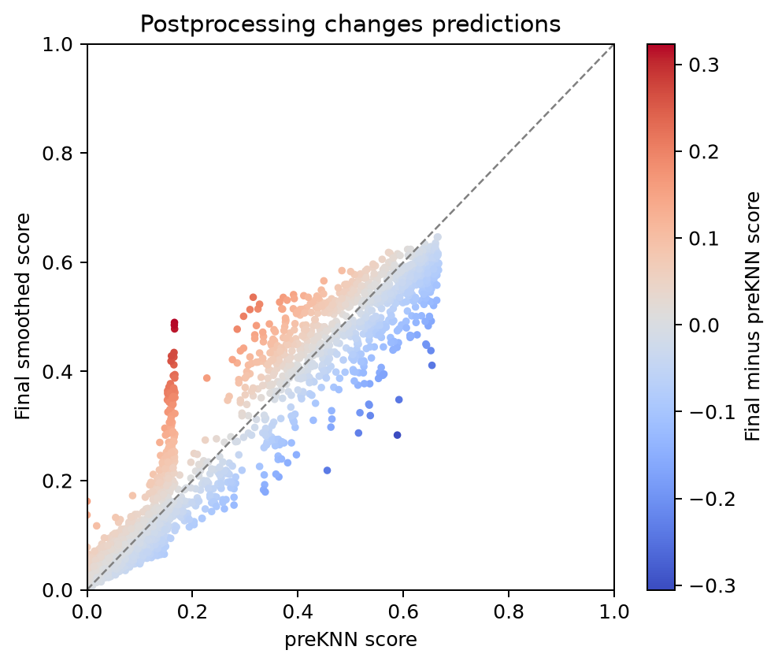

# 自适应近邻平滑前后对照（CytoTRACE2）

1. **名称与方法**：自适应近邻平滑前后对照，CytoTRACE2官方预测API及本仓库独立绘图。
2. **论文/教程来源**：[Kang等2025](https://doi.org/10.1038/s41592-025-02857-2)、[官方Python教程](https://github.com/digitalcytometry/cytotrace2/tree/main/cytotrace2_python)。不是复制官方截图。
3. **实际数据与脚本**：官方小鼠胰腺完整2850细胞；[输入来源及SHA256](../results/input_download_provenance.json)。[01输入/UMAP](../scripts/01_Input_QC_and_Embedding.py)、[02预测](../scripts/02_Predict_and_Statistics.py)、[03绘图](../scripts/03_Plot_and_Export.py)。[数值摘要](../results/run_summary.json)。
4. **图形元素**：横轴preKNN分数，纵轴最终分数；虚线y=x；颜色为最终减去preKNN的差。preKNN已含扩散和重标定，不是原网络输出。
5. **回答的问题**：邻域后处理对数值和局部排序的影响有多大？
6. **本次解释**：实际平滑前后Spearman rho=0.9631；偏离对角线表示后处理改变了分数，不自动表示纠正了真实生物学误差。
7. **局限与常见误读**：分批限定了平滑邻域，不能声称与完整单批等价；同一表达衍生的邻域与潜能不是独立证据。
8. **PI预设用途**：State交界处重点记录后处理变化，若结论依赖平滑则作为敏感性限制，并寻求独立功能读出。 本轮未运行真实PI。

下载：[PNG](../figures/CT05_smoothing_comparison.png) / [PDF](../figures/CT05_smoothing_comparison.pdf) / [SVG](../figures/CT05_smoothing_comparison.svg)。所有三种格式来自同次本地绘图，不是占位。完整参数、资源适配与科学边界见[中文指南](../README_CN.md)。
