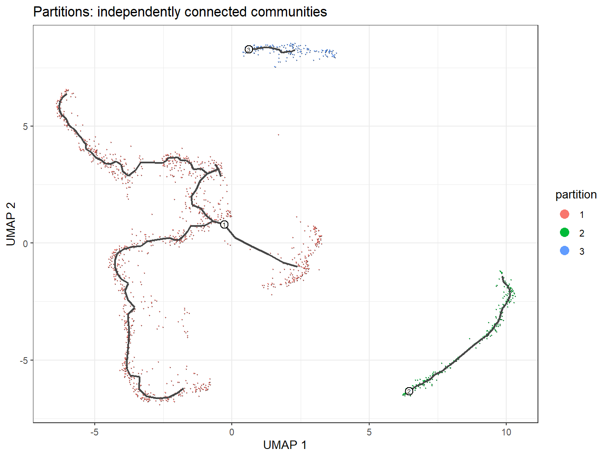
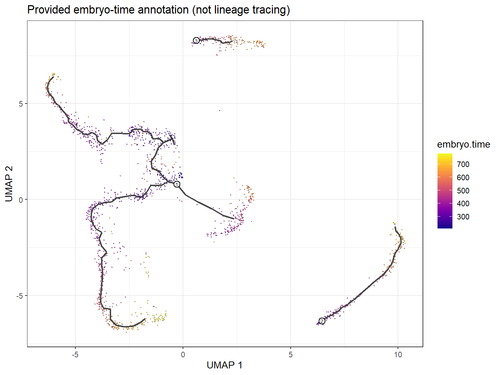
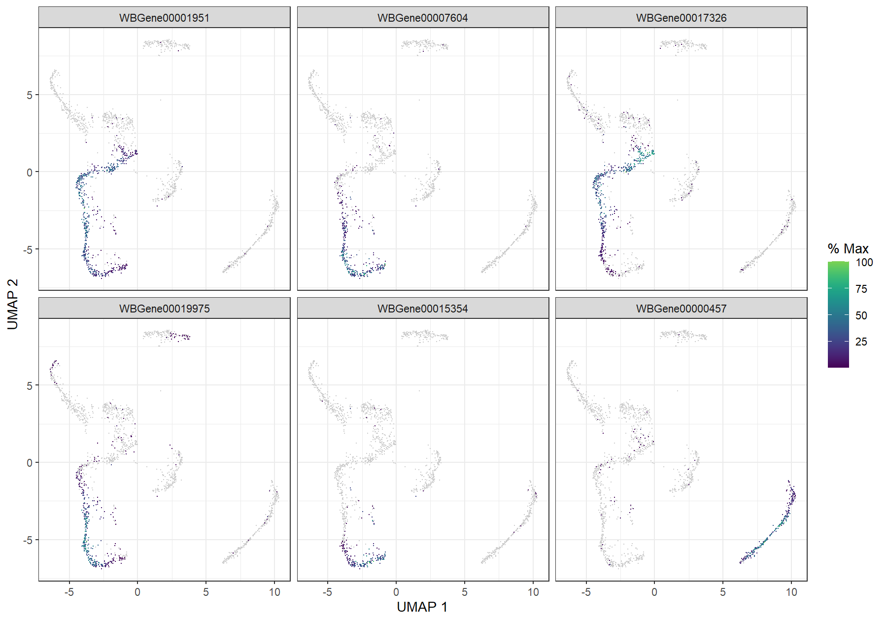

# Monocle3：主图、分区与拟时序的中文实践指南

本轮在独立 R 4.6.1 包库实际安装并运行 Monocle3 1.4.27、BPCells 0.3.1。使用作者仓库 `inst/extdata/worm_embryo` 小型官方数据：**10,000个既有筛选基因、1,805个胚胎神经元**。完成预处理、降维、主图、根选择、拟时序、动态基因和六组PNG/PDF/SVG图。完整结果见 [首次日志](logs/01_official_run.log)，安装和警告见 [环境记录](../../environments/round3/README_CN.md)。这不是原始大型胚胎图谱或论文全部图件的复现。

官方 [GitHub](https://github.com/cole-trapnell-lab/monocle3)、[安装](https://cole-trapnell-lab.github.io/monocle3/docs/installation/)、[入门](https://cole-trapnell-lab.github.io/monocle3/docs/getting_started/)、[轨迹](https://cole-trapnell-lab.github.io/monocle3/docs/trajectories/)、[动态基因](https://cole-trapnell-lab.github.io/monocle3/docs/differential/)。方法背景论文 [Cao等，2019](https://doi.org/10.1038/s41586-019-0969-x)。小例的来源/筛选记录在官方 [NOTES](https://github.com/cole-trapnell-lab/monocle3/blob/v1.4.27/inst/extdata/worm_embryo/NOTES)，来自Packer胚胎数据并挑选神经元和变异基因。示例物种与方法背景论文中的研究系统不能混为一谈。

## 适合解决什么问题

Monocle3从表达结构中学习低维图，用于提出连续状态、分支和相对进程假设，并寻找图上表达相似性较强的基因。适合连续细胞系统、采样覆盖较密、技术混杂可审查的数据。它不要求spliced/unspliced（已剪接/未剪接RNA）计数，因而不能只靠本模型给出RNA velocity（RNA速度）或真实转变速率。

不适合把互不相关细胞类型强行连成一棵树、以疾病分组替代发育根、只有终点没有中间状态却寻找完整分叉，或把计算终点当作已证明的终末分化。真实时间和谱系追踪可帮助检验模型，不能由拟时序自己产生。

## 四个核心概念

**主图（principal graph）** 是在低维表示上学习的节点/边结构，用少量代表点概括细胞连续分布。节点不是单个真实细胞，边不是已观测到的迁移路线。学习和剪枝参数可能改变局部支路；图上节点编号不是状态名称。

**分区（partition）** 是细胞邻域连通结构的较大分组，通常由聚类及群间连通检验得到。一个分区可含多个细胞簇（cluster）和分支；分区不等于细胞类型。默认在各分区内学习主图，互不连接的分区需要分别解释，不应为了好看关闭分区约束。

**分支（branch）** 指主图在连接度通常至少3的节点附近分岔形成的路径；叶节点连接度为1。分支数、聚类数、细胞类型数和生物命运数没有一一对应。小支路可能来自噪声、密度变化或降维，不能自动命名为新命运。

**拟时序（pseudotime）** 是细胞投影位置到指定根的图上相对距离。`order_cells` 指定方向和距离，不会重新学习拓扑。换根会改变时间，但不证明新方向真实；无根可达的细胞可得到Inf（无限值），不能用最大有限值填补。不同分区各自选根后的时间不共享生物学零点或单位。

## 输入与准备

基因×细胞非负整数计数优先用 `dgCMatrix`（R稀疏矩阵）保存。细胞元数据行名必须与计数列名完全一致；基因元数据行名与计数行名完全一致，并提供 `gene_short_name`（显示用符号）。保存供者、条件、批次、收集时间、状态注释及质量信息；不能只保留最终UMAP。

Seurat v5使用 `LayerData(obj, assay='RNA', layer='counts')`；v4可用 `GetAssayData(...,slot='counts')`。多layer需核查每层细胞，按ID组装；不要将整合或scale表达作为原始计数。AnnData中先确认原始计数所在layer，再由细胞×基因转为基因×细胞，导出obs/var索引并检查顺序。没有原始counts时，停止这里的计数工作流，不能将小数四舍五入伪装为计数。

本例稀疏表达对象约9.9 MB。其10,000基因是官方既有变异筛选结果，并不是完整转录组。元数据中 `embryo.time` 和时间分箱是已有胚胎时间注释，不能称为对每个细胞连续实测的时钟；收集时间、推断胚胎时间和本轮拟时序要分别记录。

## 安装与统一入口

本机使用独立包库，没有调整系统默认R、scTour或RegVelo。Windows安装需实际验证编译器、HDF5（层次数据格式5）及BPCells等依赖，不能将 `install_github` 一行视为安装成功。本轮使用官方二进制依赖、官方源代码、工作区本地工具链和单任务编译。工具链深路径问题通过临时短路径头文件搜索修复；全部真实失败与成功日志均保留在 [安装目录](../../environments/round3/README_CN.md)。

从仓库根执行：

```r
options(toolkit.library='你的独立包库')
source('round3/00_Start.R', encoding='UTF-8')
source('methods/Monocle3/scripts/01_Load_and_Check.R', encoding='UTF-8')
source('methods/Monocle3/scripts/02_Learn_and_Order.R', encoding='UTF-8')
source('methods/Monocle3/scripts/03_Dynamic_Genes.R', encoding='UTF-8')
source('methods/Monocle3/scripts/04_Plot_and_Export.R', encoding='UTF-8')
```

或 `Rscript methods/Monocle3/scripts/run_example.R`。00集中配置，01只读一次输入，02学习轨迹并存盘，03做基因检验及6基因展示曲线拟合，04只负责图件导出。VS Code R Interactive可逐段运行；重绘在新会话先00再04，读取保存对象，不重训轨迹。

| 步骤/参数 | 本次取值 | 应如何理解 |
|---|---|---|
| preprocess_cds | PCA、log标准化、50维 | 主成分分析（principal component analysis，PCA）压缩表达；50是本官方NOTES设置 |
| align_cds | batch及7个背景RNA协变量 | 使用官方建议校正，不保证不会移除真实发育差异 |
| reduce_dimension | UMAP，15邻居，fast_sgd=FALSE，cores=1 | UMAP（统一流形近似与投影）邻域/随机性可影响图形 |
| cluster_cells | 固定随机种子20261019 | 聚类和分区依赖邻域结构；不是生物类型鉴定 |
| learn_graph | use_partition=TRUE，close_loop=FALSE | 不连不同分区，不拟合闭环；不适用于想研究细胞周期闭环的所有情况 |
| order_cells | 各分区最早非空时间分箱投票选根 | 不硬编码旧教程节点编号，不自动翻转提高相关性 |
| graph_test | principal_graph，cores=1 | Moran's I图自相关；检验前按表达覆盖过滤 |

本小数据没有官方大教程中的130–170分箱细胞；照抄那个根选择条件会失败。本例按相同“早期细胞最近图节点投票”思路在每个分区选择最早非空分箱。根选择不是独立生物证据：分区2只有2个最早候选细胞支持根，分区3最早已有较晚时间注释，方向应谨慎。

实际3个根为Y_13（分区1，78个候选、210–270）、Y_107（分区2，2个、270–330）、Y_138（分区3，24个、390–450）。主图148个节点，1,805个细胞均得到有限时间。有限时间只说明图可达，不说明三个根具有同等可靠性。

## 动态基因和输出

Moran's I（莫兰空间自相关统计量）衡量图邻域细胞的表达是否相似。正值较高可提示图结构化表达；它不是沿唯一时间方向上升的效应，也不是调控因果强度。本轮先过滤“至少20个细胞有计数”的基因，在5,921个合格基因中串行检验，全部状态为OK，其中3,294个q<0.05。该结果条件于当前细胞、基因筛选、邻域和主图。

`graph_test.tsv` 保存全部合格基因的状态、p值、q值、Moran's I及显示名；`gene_test_universe.tsv` 保留哪些基因被过滤。不要只留下显著列表。`cell_trajectory.tsv` 保存分区、聚类、UMAP和时间；`graph_nodes/edges.tsv` 保存图结构；`root_choices.tsv` 保存根依据。

`cds_trajectory.rds` 可重绘此处图件，但官方警告 **saveRDS不会保存Annoy/HNSW近邻索引**。它不是可无损恢复所有后续操作的完整Monocle项目，BPCells磁盘矩阵还涉及外部文件。继续新分析应重建索引或按官方 `save_monocle_objects` / `load_monocle_objects` 完整保存；本轮仅声明稀疏内存对象的分析/重绘验证通过，没有验证磁盘BPCells对象迁移。

## 六组实际图件的中文阅读


M01：点颜色是9类官方神经元注释，黑线为学习的主图，横纵轴是UMAP；数字圆圈是根标签，不是State 1/6/7。它展示注释与连续结构的关系，不能把UMAP二维形状当成真实发育树。



M02：3种分区标签强调不连通结构。没有跨分区黑边是需要保留的信息，不是缺图。不可因两个分区位置接近就手工合并，或因图断开就断言生物学完全无关联。


M03：色条表示从各自根计算的相对图距离。三个分区可以各自从0开始，不共享同一个发育零点。深浅色不能换算为分钟，线条没有真实方向箭头；根的依据来自外部注释而非颜色本身。



M04：按提供的 `embryo.time` 注释着色，可与拟时序对照；它与当前图都来自表达相关信息时不构成完全独立验证。若时间趋势不符，应调查根、混合状态、批次和注释来源，不应倒转图直至一致。



M05：六个图展示按q值、再按Moran's I选择的基因在UMAP上的表达。颜色范围为官方plot_cells的表达显示尺度，色条是% Max（每基因最大显示表达的百分比），不是原始计数。空间结构化不一定等于沿一个方向单调变化；分支/细胞类型特异也会产生高自相关。


M06：为避免把3个不连通分区强行混合拟合，展示范围限定为Neuroblast_ASG_AWA / ASG_AWA / AWA注释的同一主要分区。每个面板一基因，点颜色为注释，曲线是官方绘图函数生成的描述性平滑；六个基因先按全图检验及局部检出比例≥20%选取，因此不是在该局部路径上另行证明动态显著。曲线由分析阶段保存后重绘，不用于定位不可逆命运点。使用细胞清单见 `M06_display_cells.tsv`。

每张图的来源、脚本、颜色/轴/曲线、解释与误读边界见 [逐图阅读卡](figure_notes/INDEX_CN.md)。

## 与 Slingshot / tradeSeq 的区别

| 方法 | 输入和核心结构 | 时间与动态检验 |
|---|---|---|
| Slingshot | 给定低维空间和聚类；群间MST后拟合共享主曲线 | 每谱系时间与曲线权重；可传tradeSeq |
| Monocle3 | counts预处理、UMAP、聚类/分区、分区内主图 | 根到图投影距离；Moran's I图自相关 |
| tradeSeq | 已有时间、权重及原始counts | NB-GAM表达平滑与特定对比；不重估拓扑 |

相同细胞、可解释的共同早期状态、终点覆盖和方向核查后才比较。不要把两种方法的Lineage1或分支编号当作同一谱系，也不要直接比较时间数值。主图q值和tradeSeq的FDR来自不同零假设，交集不等于真值。共同示范已实际运行并出现AWA排序/终点冲突，见 [组合报告](../../combinations/Slingshot_tradeSeq_Monocle3/AGREEMENT_LIMITATIONS_CN.md)，不能因此宣传两算法已经共同证明同一轨迹。

## PI Fibroblast 预设应用（不运行真实数据）

先确认State 1/6/7的供者、条件、质量和邻域覆盖；分别学习PI/Healthy或供者内结构，根依据应来自时间/祖状态标记/实验设计，而非默认State1就是根。将ECM合成、降解、交联重塑、Integrin–FAK–YAP/TAZ、炎症/修复集合分开登记，检查表达覆盖和供者支持。

Monocle3可以为“某程序与状态图结构相关”提供计算证据；tradeSeq进一步描述可信谱系内的表达形状及分支差异。没有独立蛋白、力学、空间或扰动数据时，不能从YAP相关mRNA曲线推断YAP核转位，从MMP表达推酶活，或从胶原mRNA推ECM沉积量。内皮互作属于后续独立分析，图上接近不能证明旁分泌信号方向。

若3状态在不同分区、根缺少支持或换批次处理后方向明显变动，停止合成全局重编程故事，转向局部状态/供者层面表达比较。完整设计见 [PI动态专题](../../case_studies/PI_Fibroblast_State_Reprogramming/ROUND3_DYNAMIC_DESIGN_CN.md)。

## 常见错误

| 现象 | 检查/解决 |
|---|---|
| gene_short_name缺失 | 补充显示名，但不能用重复符号替换稳定行ID |
| 根函数返回空 | 检查当前数据实际分箱；不要照抄大教程130–170 |
| 部分时间Inf | 检查分区和根可达性；保留Inf，不随意填补或强接图 |
| 图过多小枝/没有分叉 | 检查采样、UMAP、邻居、聚类及剪枝；参数敏感性要与主要分析分开保存 |
| 批次对齐使发育结构改变 | 比较不对齐/不同协变量流程；发育与采样批次可能混杂，不能凭相关性择优 |
| graph_test q值很小 | 联合Moran's I、表达覆盖和生物重复；大量细胞不等于大量供者 |
| 读取RDS后近邻操作失败 | 根据官方保存说明重建索引或完整保存；RDS重绘成功不代表全部索引保真 |
| Windows编译要求更新编译器 | 先读实际编译错误；本轮错误是长路径头文件缺失，并非编译器版本不足 |
| ggplot弃用警告 | 本版本官方代码仍有aes_string/size警告，本轮图已生成；保留警告，不擅自修改上游源码 |

本例的 INSTALL / INPUT / RUN / FIGURE / 中文教程验收见 [STATUS.json](STATUS.json)。结果是模型条件下的计算输出，不是谱系追踪或机制证明。
