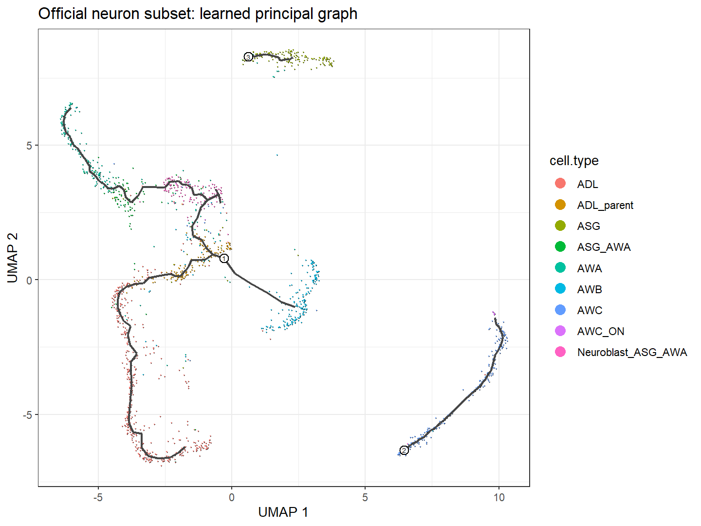

# M01_celltypes_principal_graph：细胞注释与主图

1. **图名和方法**：细胞注释与主图；Monocle3 1.4.27。
2. **官方来源**：[轨迹教程](https://cole-trapnell-lab.github.io/monocle3/docs/trajectories/)、[官方小数据NOTES](https://github.com/cole-trapnell-lab/monocle3/blob/v1.4.27/inst/extdata/worm_embryo/NOTES)、[方法论文](https://doi.org/10.1038/s41586-019-0969-x)。本图为本地计算。
3. **数据与脚本**：官方10,000×1,805小数据；[01输入](../scripts/01_Load_and_Check.R)、[02主图/根](../scripts/02_Learn_and_Order.R)、[03动态检验](../scripts/03_Dynamic_Genes.R)、[04导图](../scripts/04_Plot_and_Export.R)。来源/校验见全库数据登记。
4. **图形元素**：点色为9种官方cell.type，轴为UMAP1/2，黑线为主图；数字圆圈标识根。
5. **回答问题**：图结构与已知注释是否相容。
6. **本例解释**：主图148节点、3分区；它不是原始论文整图复刻。
7. **科学局限与误读**：UMAP形状与图边不等于真实迁移；根数字不是状态标签。
8. **PI使用场景（仅设计）**：检查1/6/7与供者分布，不预设1→6→7。

[PDF](../figures/M01_celltypes_principal_graph.pdf) · [SVG](../figures/M01_celltypes_principal_graph.svg)。可编辑脚本、统计与真实日志均保留。
