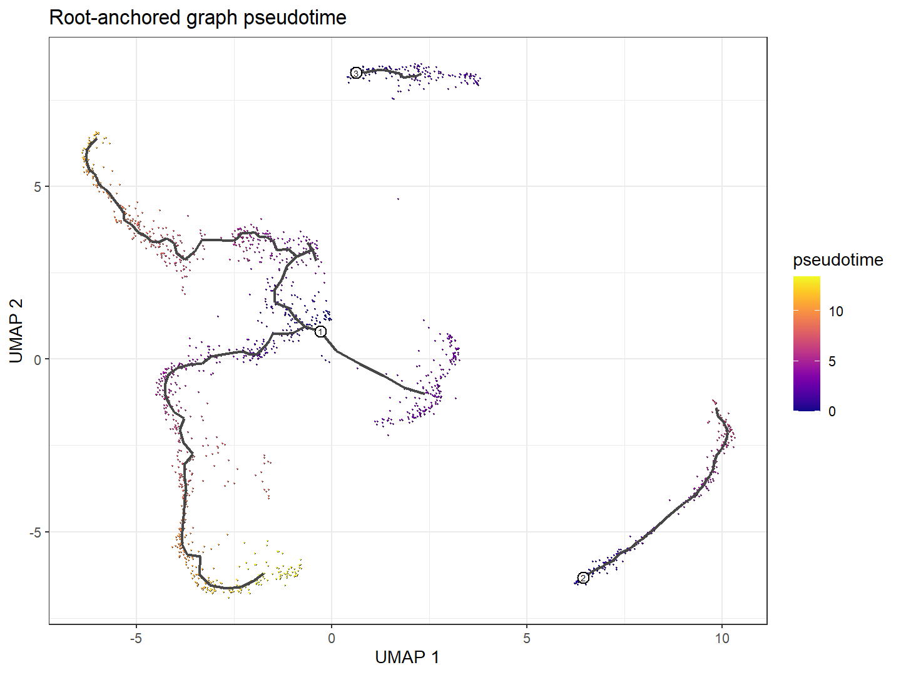

# M03_rooted_pseudotime：根锚定拟时序

1. **图名和方法**：根锚定拟时序；Monocle3 1.4.27。
2. **官方来源**：[轨迹教程](https://cole-trapnell-lab.github.io/monocle3/docs/trajectories/)、[官方小数据NOTES](https://github.com/cole-trapnell-lab/monocle3/blob/v1.4.27/inst/extdata/worm_embryo/NOTES)、[方法论文](https://doi.org/10.1038/s41586-019-0969-x)。本图为本地计算。
3. **数据与脚本**：官方10,000×1,805小数据；[01输入](../scripts/01_Load_and_Check.R)、[02主图/根](../scripts/02_Learn_and_Order.R)、[03动态检验](../scripts/03_Dynamic_Genes.R)、[04导图](../scripts/04_Plot_and_Export.R)。来源/校验见全库数据登记。
4. **图形元素**：色条为图距离，黑线是主图，数字标出三个根；没有真实时间箭头。
5. **回答问题**：相对指定根的位置如何变化。
6. **本例解释**：各分区分别按最早非空分箱投票；1805个细胞有限时间。
7. **科学局限与误读**：有限时间只代表可达；跨分区时间单位/零点不可直接比较。
8. **PI使用场景（仅设计）**：根需独立证据，预定候选根并做敏感性。

[PDF](../figures/M03_rooted_pseudotime.pdf) · [SVG](../figures/M03_rooted_pseudotime.svg)。可编辑脚本、统计与真实日志均保留。
