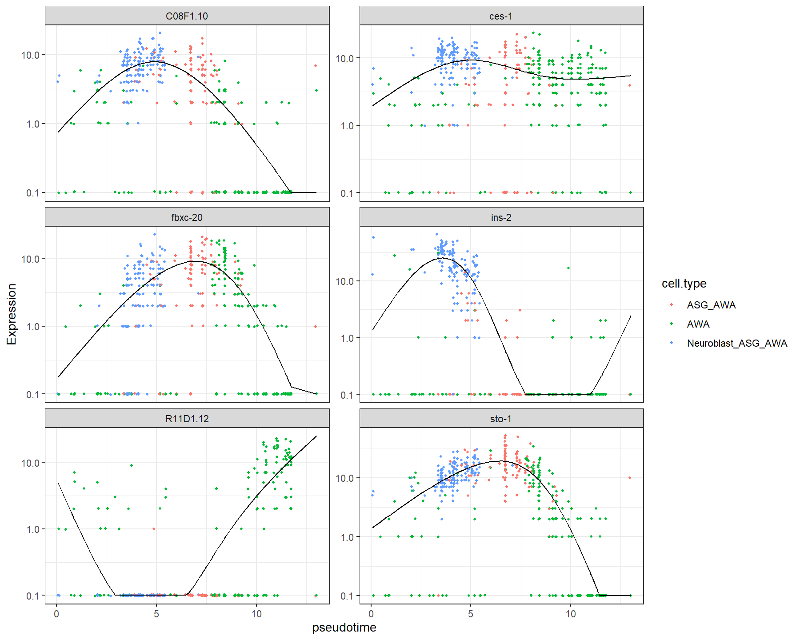

# M06_gene_expression_pseudotime：局部AWA注释路径的表达-时间示例

1. **图名和方法**：局部AWA注释路径的表达-时间示例；Monocle3 1.4.27。
2. **官方来源**：[轨迹教程](https://cole-trapnell-lab.github.io/monocle3/docs/trajectories/)、[官方小数据NOTES](https://github.com/cole-trapnell-lab/monocle3/blob/v1.4.27/inst/extdata/worm_embryo/NOTES)、[方法论文](https://doi.org/10.1038/s41586-019-0969-x)。本图为本地计算。
3. **数据与脚本**：官方10,000×1,805小数据；[01输入](../scripts/01_Load_and_Check.R)、[02主图/根](../scripts/02_Learn_and_Order.R)、[03动态检验](../scripts/03_Dynamic_Genes.R)、[04导图](../scripts/04_Plot_and_Export.R)。来源/校验见全库数据登记。
4. **图形元素**：点色为局部注释，横轴本分区拟时序，纵轴官方归一化表达显示；线是描述性平滑。
5. **回答问题**：全图动态基因在一个局部注释路径上呈现什么表达形状。
6. **本例解释**：只展示同一主要分区的Neuroblast_ASG_AWA/ASG_AWA/AWA细胞；具体ID另存。
7. **科学局限与误读**：六基因按全图显著及局部检出≥20%筛选；该曲线不是新的局部动态显著性检验，更不证明不可逆方向。
8. **PI使用场景（仅设计）**：真实PI需先确认单条路径，再看基因/程序，并保留供者层次。

[PDF](../figures/M06_gene_expression_pseudotime.pdf) · [SVG](../figures/M06_gene_expression_pseudotime.svg)。可编辑脚本、统计与真实日志均保留。

本图基因名称对照：

| 稳定ID | 官方显示名 |
|---|---|
| WBGene00000468 | ces-1 |
| WBGene00006063 | sto-1 |
| WBGene00018352 | fbxc-20 |
| WBGene00045336 | R11D1.12 |
| WBGene00015613 | C08F1.10 |
| WBGene00002085 | ins-2 |

名称仅用于识别；功能与调控关系不能从基因名字或本图直接推定。
