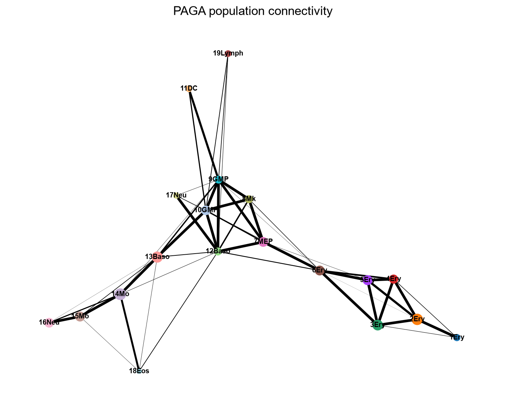
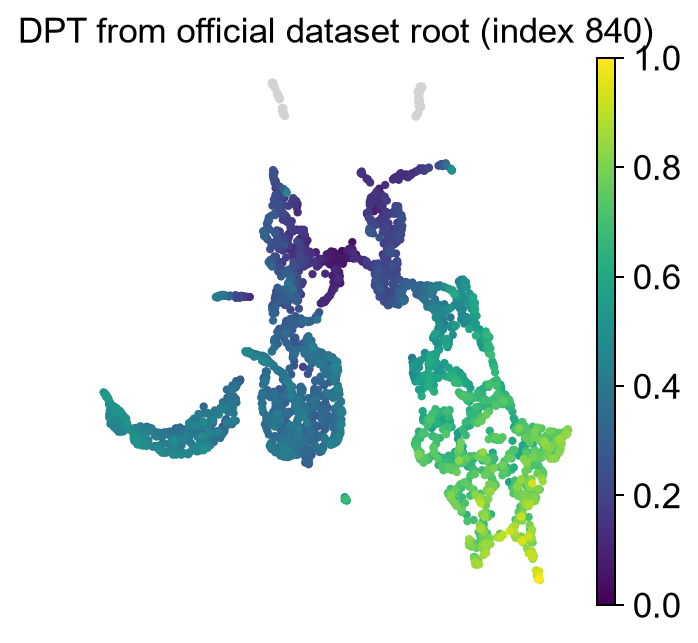
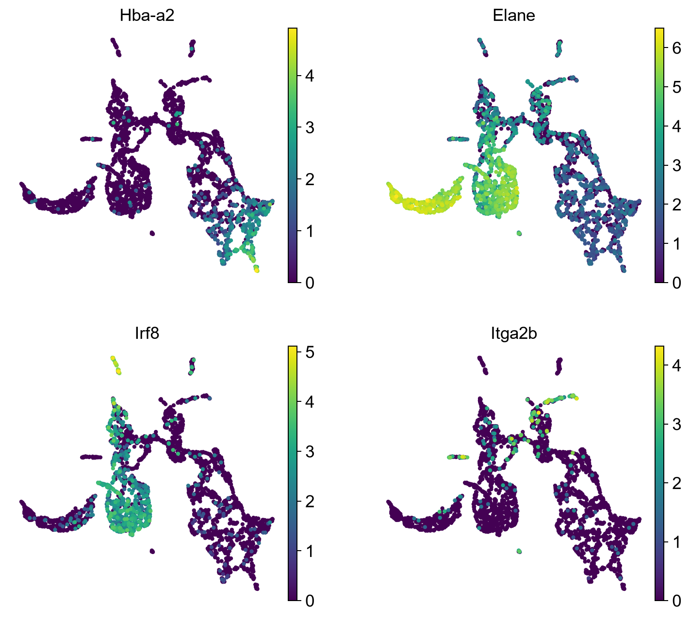

# PAGA：群体连接拓扑与扩散拟时序中文指南

本轮已真实运行官方Paul15小数据，输入 **2730细胞×3451个提供基因**，输出4组12个PNG/PDF/SVG。它是Scanpy官方教程小例的有记录改编，不声称逐像素复制全篇教程；使用官方群注释代替新Louvain分群和手工改名，用PAGA初始化的UMAP代替ForceAtlas2布局。原第三轮三方法及AWA冲突不变。

## 原理、来源与问题选择

基于分区的图抽象（partition-based graph abstraction，PAGA）把细胞近邻图压缩为群体图。先有细胞的k近邻图（k-nearest neighbors graph，kNN），再给定分群；群间实测连接相对随机期望的归一化度量用于描述群体连续性。节点代表群，边代表连接，不直接给出根、方向、分支命运或转化概率。连接权重不是相关系数、p值，也没有自动的FDR解释。

适合问“哪些群之间有连续桥梁”“离散群结构与连续状态能否同时描述”“不同分群/邻居参数下拓扑是否稳定”。不适合只凭边证明State1→State6→State7、估算转化频率、把疾病/健康标签当真实时间，或把UMAP上两个群接近当作连接证据。细胞密度、批次、双细胞和混合谱系都可产生伪桥。

原论文：[Wolf等，Genome Biology 2019](https://doi.org/10.1186/s13059-019-1663-x)；[原始论文代码](https://github.com/theislab/paga)；[Scanpy官方实现](https://github.com/scverse/scanpy)；[官方Paul15教程](https://scanpy.readthedocs.io/en/stable/tutorials/trajectories/paga-paul15.html)；[API](https://scanpy.readthedocs.io/en/stable/api/scanpy.tl.paga.html)。数据研究：[Paul等，Cell 2015](https://doi.org/10.1016/j.cell.2015.11.013)。来源内容与hash见[官方来源记录](results/official_sources.json)。Scanpy BSD-3-Clause声明已保留；原始HDF5不随Git提交，包许可不能自动扩大原始研究数据权利。

## 输入与数据准备

输入为AnnData（带细胞与基因注释的矩阵对象），通常细胞×基因；细胞ID唯一且与obs/嵌入严格对应，obs中分群是分类变量。PAGA实际使用邻居图，而非直接对UMAP坐标连线。全长原始计数不是其唯一可接受输入，但邻居空间必须有可说明的表达来源、筛选和尺度。

本例由`sc.datasets.paul15()`读取官方`data.debatched`非对数信息基因矩阵。它不是未经校正的完整原始整数计数：非整数比例0.0000。本轮不把它输入tradeSeq计数模型。提供基因总量也不等于完整测序深度；QC相关性只能覆盖当前基因面板。输入URL、字节、SHA256、细胞和根见[输入登记](results/input_provenance.json)。下载前设64 MiB输入上限；超过即停止。

Seurat导出时保留RNA表达、基因/细胞ID和供者/条件/批次；用可靠转换器构造AnnData，转置时检查轴向。若用整合表示建立邻居，原始计数仍单独保存，说明整合是否可能移除真实状态差异。AnnData中.X不必然是计数；不要重复log1p。真实PI需分离Fibroblast、处理双细胞/污染，不能将内皮细胞混入同一谱系而称跨谱系转化。

## 安装、参数与运行顺序

读[独立环境](../../environments/round4/PAGA/README_CN.md)，激活相应Python后从仓库根运行：

```powershell
python -X utf8 methods/PAGA/scripts/run_example.py
# 仅重绘，不重建邻居图：
python -X utf8 methods/PAGA/scripts/run_example.py --replot
```

01下载、检查、加载；02预处理和计算；03独立绘图。00集中参数可在VS Code Python交互会话中按顺序执行。正常入口只加载一次输入，后续复用内存对象；重绘一次读取已处理h5ad。图统一白底，三格式导出。重跑会更新PAGA自己的结果，比较新参数前另存版本目录；不会调用第三轮脚本。

| 参数 | 本轮值 | 含义 |
|---|---|---|
| seed | 0 | PCA/邻居/布局随机种子；跨版本不保证逐数值一致 |
| first_neighbors / n_pcs | 4 / 20 | 官方流程的初始表达邻居 |
| diffmap_components | 15 | 扩散映射（diffusion map）表示的分量数 |
| final_neighbors | 10 | 在扩散表示上重新建图，不在UMAP上建图 |
| groups | paul15_clusters | 官方19群注释；群定义会影响PAGA结果 |
| display_threshold | 0.03 | 仅控制显示哪些边，不是显著性阈值 |
| root_index | 840 | 官方数据默认根；须随细胞ID保存，不能跨重排复用数字 |
| DPT n_dcs | 10 | 扩散拟时序（diffusion pseudotime，DPT）使用的分量数 |

本例根细胞为`W37022`，官方群为`8Mk`。该根落在8Mk，不能称为已验证的干祖细胞起点；本例仅演示根条件排序。PAGA群图本身无方向；DPT另由根产生相对排序。

## 实际统计与图件

PAGA得到19个群、58条非零无向群边，其中54条超过显示阈值；DPT有限值2671个、非有限59个。不能将有穷时间当作祖先证据或把无穷值补为0。参数、耗时及改编记录见[运行汇总](results/run_summary.json)。统计输出为[PAGA矩阵](results/PAGA_connectivities.csv)、[边表](results/PAGA_edges.csv)、[逐细胞结果](results/cell_statistics.csv)及[DPT与技术量相关](results/DPT_QC_correlations.csv)；后者是描述性细胞层相关，未控制供者/群身份，p值不是供者级证据。








逐图学习：[P01连接图](figure_notes/P01_population_topology_CN.md)、[P02嵌入](figure_notes/P02_PAGA_initialized_UMAP_CN.md)、[P03拟时序](figure_notes/P03_DPT_pseudotime_CN.md)、[P04表达](figure_notes/P04_marker_expression_CN.md)。图和坐标来自实际本机计算，未保存官方截图。

## 与Monocle3、Slingshot的区别与组合

| 方法 | 拟合对象与先验 | 合法比较 | 不可直接比较 |
|---|---|---|---|
| PAGA | 群级邻居连接，依赖群与邻居图 | 群之间是否有稳健桥梁 | 边权不是时间、命运概率或MC图长度 |
| Monocle3 | 分区内主图（principal graph）及根到图上的距离 | 同细胞、同方向前提下的局部排序/终点覆盖 | 断开分区时间不能拼接，节点不是PAGA群 |
| Slingshot | 聚类最小生成树与同时主曲线（principal curves） | 共享细胞的逐谱系顺序/表达趋势 | 曲线权重不是PAGA连接，也不是命运概率 |

先独立处理同一数据，核对细胞ID和合法表达尺度，再比较群桥、根与终点、逐谱系排序；不能只看二维形状。不同算法共享同一邻居/群先验时，一致性不是独立验证。官方Paul15与tradeSeq的Paul15筛选面板同属研究，也必须重新核查细胞ID，不能因名字相同直接拼接。与CytoTRACE2组合只检查潜能与结构/排序是否一致；与CellRank组合需另定义方向核，不把PAGA无向边当转移概率。本轮没有新增三方法联合验证；第三轮AWA FAIL保持不变。

## PI Fibroblast预设设计

本例是小鼠造血示范，不是PI数据或人纤维细胞验证。本轮PI只做设计。State1/6/7应先作为待检验注释，保留供者、PI/Healthy、批次和混合状态。独立检查ECM合成（COL1A1/COL1A2/DCN等）、降解（MMP/TIMP平衡）、重塑（LOX/FN1等）、Integrin–FAK–YAP/TAZ（整合素–黏着斑激酶–机械转导效应因子）及炎症/修复程序，避免把一种胶原高表达叫全部ECM活跃。

可比较按状态与无监督聚类的PAGA，并按供者重采样检查桥梁稳定性；同时绘制供者/条件/检测基因覆盖与程序分数。程序分数及通路富集需在真实PI内另行计算，不能从小鼠造血图推导。机械转导需蛋白磷酸化、YAP/TAZ核定位、基质/力学干预等验证；转录本高不等于通路活性。若桥梁由单一供者、低质量或双细胞支撑，或改变邻居/群划分后消失，则STOP/PIVOT为状态差异研究。内皮互作另做样本匹配的配体受体/空间假设，不由PAGA边推断跨细胞转化。

## 常见错误与边界

- Numba DLL导入失败：先核查VC++运行库；本机仅在新venv内解决。不要降级/替换其他科研环境。
- 根索引失效：用保存的cell ID重新定位，检查过滤和排序；未满足方向依据时仅报告无向拓扑。
- PAGA初始化UMAP缺pos：先用官方paga绘图函数建立群图布局；布局是展示，不是新增命运模型。
- DPT出现Inf：检查连通分量及根覆盖，分区单独分析，不填0或强行连边。
- 群边随参数改变：检查邻居空间、样本混杂、群大小和注释；保留冲突，不调到“符合预期”。
- 当前方法不输出FDR基因检验、潜能或命运概率，不用这些词描述连接权重。

真实失败和成功日志见logs目录；最终独立验收见[STATUS](STATUS.json)。
