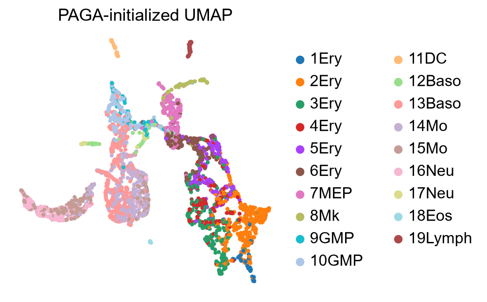

# PAGA初始化的UMAP（PAGA）

1. **图名与方法**：PAGA初始化的UMAP；PAGA/Scanpy。
2. **官方来源**：[Paul15教程](https://scanpy.readthedocs.io/en/stable/tutorials/trajectories/paga-paul15.html)，[原论文](https://doi.org/10.1186/s13059-019-1663-x)。本图由本机生成，与全教程布局/分群改编见[指南](../README_CN.md)。
3. **实际数据与脚本**：2730个小鼠造血细胞；[输入校验](../results/input_provenance.json)，[计算](../scripts/02_PAGA_and_DPT.py)，[绘图](../scripts/03_Plot_and_Export.py)。[PDF](../figures/P02_PAGA_initialized_UMAP.pdf) / [SVG](../figures/P02_PAGA_initialized_UMAP.svg)。
4. **图形元素**：每点为同一个细胞，颜色为官方群；坐标为UMAP1/2，无物理单位。初始位置来自群图，之后UMAP优化；群间距离与面积不保真。
5. **回答的问题**：群级结构在细胞嵌入中如何呈现？
6. **示例解读**：结合P01与标志物读群邻域；不是在UMAP上重新估计PAGA边。
7. **局限与误读**：PAGA初始化会影响布局，形状相似不等于独立验证；图中没有实测迁移轨迹。
8. **PI预设用途**：并列标供者、状态、ECM程序和QC；不能单靠视觉桥梁宣称State转变。 本轮未运行真实PI。
