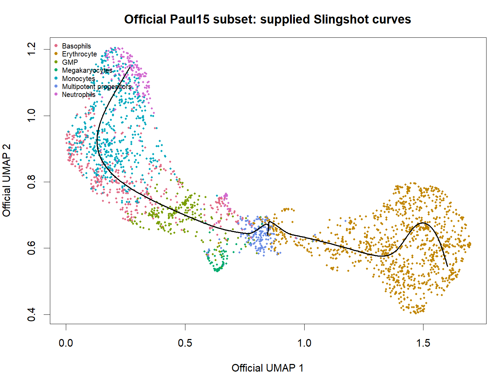

# T01_official_trajectory：官方UMAP与配套轨迹

1. **名称和方法**：官方UMAP与配套轨迹；tradeSeq 1.26.0，Slingshot提供上游轨迹。
2. **原始来源**：[tradeSeq官方工作流](https://statomics.github.io/tradeSeq/articles/tradeSeq.html)，[方法论文](https://doi.org/10.1038/s41467-020-14766-3)。本图为本地重新计算结果，未复制截图。
3. **数据和脚本**：官方Paul15 subset，240×2660；[01输入](../scripts/01_Load_and_Check.R)、[02拟合](../scripts/02_Fit_and_Test.R)、[03绘图](../scripts/03_Plot_and_Export.R)。输入及模型位于results，来源与hash见全库数据登记。
4. **图形元素**：点颜色对应7类官方细胞类型；横纵轴为官方UMAP1/2；黑线为既有Slingshot曲线，未添加方向箭头。
5. **回答的问题**：检验下游所依赖的轨迹和细胞类型覆盖是否直观合理。
6. **本例解释**：使用同一包内counts/crv/celltype；不是第二轮140点模拟。
7. **科学局限和常见误读**：黑线不等于细胞迁移路径，UMAP距离和分支不能替代谱系追踪。
8. **PI中用法（仅设计）**：PI中先展示1/6/7的细胞与供者覆盖，再讨论连续性。

[PDF](../figures/T01_official_trajectory.pdf) · [SVG](../figures/T01_official_trajectory.svg)。实际统计表与日志均保留，不用图片代替检验。
