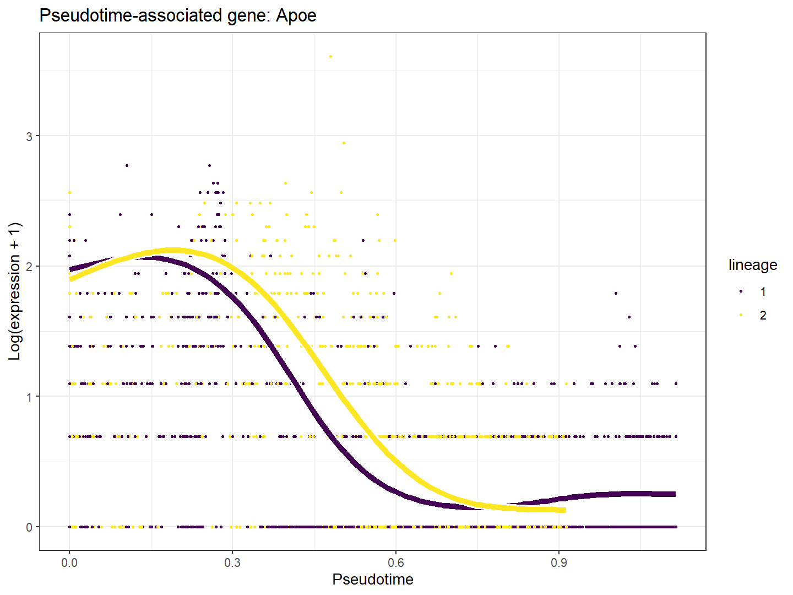

# T02_expression_smoothers：Apoe表达平滑曲线

1. **名称和方法**：Apoe表达平滑曲线；tradeSeq 1.26.0，Slingshot提供上游轨迹。
2. **原始来源**：[tradeSeq官方工作流](https://statomics.github.io/tradeSeq/articles/tradeSeq.html)，[方法论文](https://doi.org/10.1038/s41467-020-14766-3)。本图为本地重新计算结果，未复制截图。
3. **数据和脚本**：官方Paul15 subset，240×2660；[01输入](../scripts/01_Load_and_Check.R)、[02拟合](../scripts/02_Fit_and_Test.R)、[03绘图](../scripts/03_Plot_and_Export.R)。输入及模型位于results，来源与hash见全库数据登记。
4. **图形元素**：点为单细胞原始计数经log(1+count)显示，横轴是Slingshot拟时序，曲线颜色区分谱系；拟合值基于归一化偏置和NB-GAM。
5. **回答的问题**：给定轨迹，表达是否沿进程变化，变化形状是否单调。
6. **本例解释**：Apoe按默认association结果的FDR、p值、Wald统计量和基因名选取；见figure_genes.txt。
7. **科学局限和常见误读**：散点不是重复时间测量；曲线不含因果方向证据，计数散布不等于模型置信区间。
8. **PI中用法（仅设计）**：PI中可替换为预登记ECM/机械转导/炎症基因，分层检查供者支持。

[PDF](../figures/T02_expression_smoothers.pdf) · [SVG](../figures/T02_expression_smoothers.svg)。实际统计表与日志均保留，不用图片代替检验。
