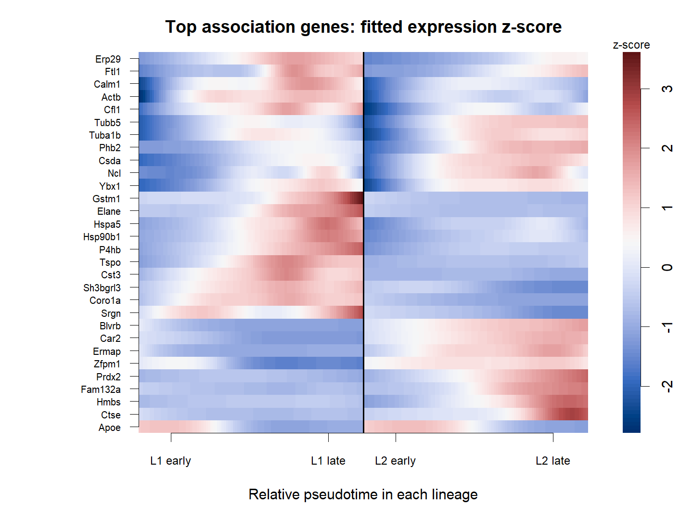

# T03_dynamic_gene_heatmap：动态基因平滑热图

1. **名称和方法**：动态基因平滑热图；tradeSeq 1.26.0，Slingshot提供上游轨迹。
2. **原始来源**：[tradeSeq官方工作流](https://statomics.github.io/tradeSeq/articles/tradeSeq.html)，[方法论文](https://doi.org/10.1038/s41467-020-14766-3)。本图为本地重新计算结果，未复制截图。
3. **数据和脚本**：官方Paul15 subset，240×2660；[01输入](../scripts/01_Load_and_Check.R)、[02拟合](../scripts/02_Fit_and_Test.R)、[03绘图](../scripts/03_Plot_and_Export.R)。输入及模型位于results，来源与hash见全库数据登记。
4. **图形元素**：每行基因、每谱系100个等间隔网格，黑线分隔；色条为log1p拟合均值的行z分数。
5. **回答的问题**：多个动态程序在不同谱系的相对位置是否不同。
6. **本例解释**：前30个默认association有效结果；层次聚类只是行展示顺序，未做额外表达分组检验。
7. **科学局限和常见误读**：网格不是细胞；颜色不能跨基因比较绝对量；预筛面板不能代表全基因组。
8. **PI中用法（仅设计）**：PI中预登记胶原合成、降解、重塑集合并标记同一基因的重叠归属。

[PDF](../figures/T03_dynamic_gene_heatmap.pdf) · [SVG](../figures/T03_dynamic_gene_heatmap.svg)。实际统计表与日志均保留，不用图片代替检验。
