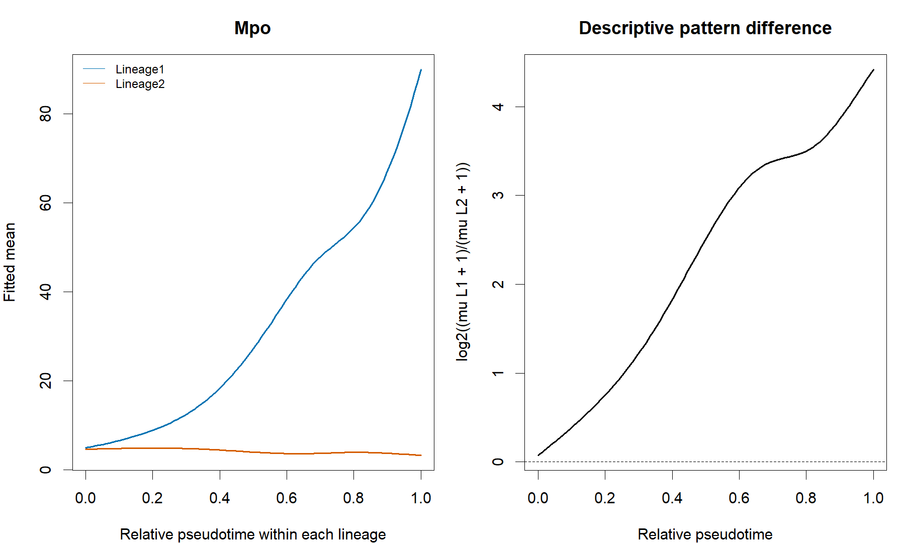

# T04_lineage_pattern_difference：Mpo分支拟合与描述差值

1. **名称和方法**：Mpo分支拟合与描述差值；tradeSeq 1.26.0，Slingshot提供上游轨迹。
2. **原始来源**：[tradeSeq官方工作流](https://statomics.github.io/tradeSeq/articles/tradeSeq.html)，[方法论文](https://doi.org/10.1038/s41467-020-14766-3)。本图为本地重新计算结果，未复制截图。
3. **数据和脚本**：官方Paul15 subset，240×2660；[01输入](../scripts/01_Load_and_Check.R)、[02拟合](../scripts/02_Fit_and_Test.R)、[03绘图](../scripts/03_Plot_and_Export.R)。输入及模型位于results，来源与hash见全库数据登记。
4. **图形元素**：左图每条谱系一条拟合均值；右图是log2((mu1+1)/(mu2+1))；虚线为零差异。
5. **回答的问题**：两条谱系的整体变化模式在何处呈现描述性分离。
6. **本例解释**：Mpo由patternTest的稳定排序选取；右侧差值使用各谱系相对0–1网格。
7. **科学局限和常见误读**：不同0.5未必同生物阶段；+1差值不是原检验效应量；无逐网格显著性或真实分叉点证明。
8. **PI中用法（仅设计）**：PI中可比较候选ECM重塑与炎症分支，但须先匹配祖状态与阶段。

[PDF](../figures/T04_lineage_pattern_difference.pdf) · [SVG](../figures/T04_lineage_pattern_difference.svg)。实际统计表与日志均保留，不用图片代替检验。
