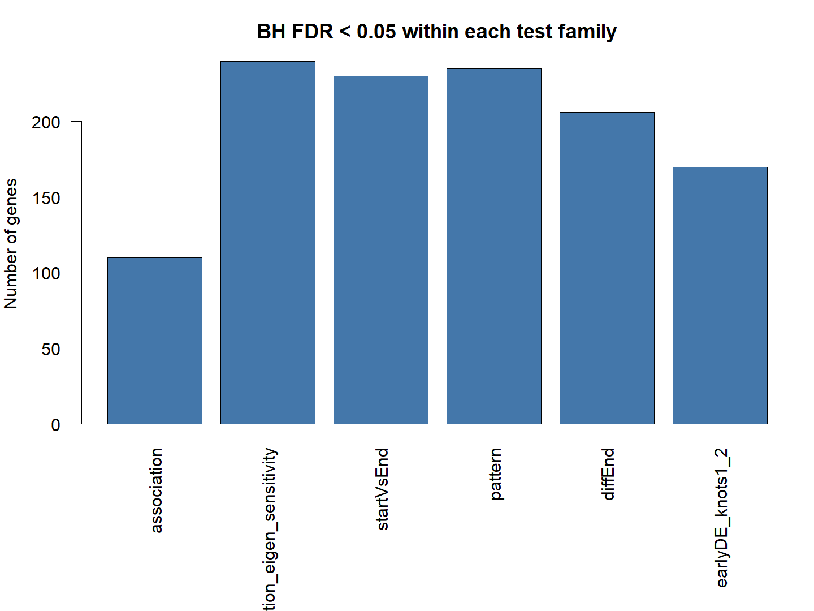

# T05_test_summary：动态检验与数值敏感性汇总

1. **名称和方法**：动态检验与数值敏感性汇总；tradeSeq 1.26.0，Slingshot提供上游轨迹。
2. **原始来源**：[tradeSeq官方工作流](https://statomics.github.io/tradeSeq/articles/tradeSeq.html)，[方法论文](https://doi.org/10.1038/s41467-020-14766-3)。本图为本地重新计算结果，未复制截图。
3. **数据和脚本**：官方Paul15 subset，240×2660；[01输入](../scripts/01_Load_and_Check.R)、[02拟合](../scripts/02_Fit_and_Test.R)、[03绘图](../scripts/03_Plot_and_Export.R)。输入及模型位于results，来源与hash见全库数据登记。
4. **图形元素**：柱高为各检验表中FDR<0.05的基因数；每类独立BH、n=240，NA留空。
5. **回答的问题**：不同问题和求逆算法如何影响有效检验和发现数。
6. **本例解释**：默认association有效114/显著110；eigen240/240；其余为230、235、206、170。
7. **科学局限和常见误读**：发现多不表示更准确；不同检验依赖同一数据，不能把交集当独立重复。
8. **PI中用法（仅设计）**：PI项目应同时报告模型收敛、有效检验数、效应与供者支持，而非只放显著数。

[PDF](../figures/T05_test_summary.pdf) · [SVG](../figures/T05_test_summary.svg)。实际统计表与日志均保留，不用图片代替检验。
